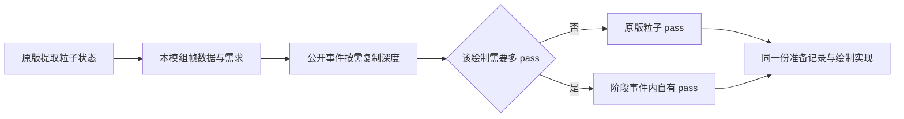

# 世界特效渲染管线设计

## 1. 基准与结论

**状态：通用管线与首个光束消费者已接入。** 当前提供视图上下文、按需不透明深度、原版粒子桥接、独立阶段任务和有预算的纹理租约；光束参数与几何仍以 [99_光束粒子渲染设计](99_光束粒子渲染设计.md) 为准。深度增强默认关闭，屏幕泛光与自动多 pass 路由未实现。编译、真实 GLSL 离屏、受控命令检查与 16/16 GameTest 已通过；游戏客户端尚未实跑，不能据此宣称第三方渲染兼容。

基准为本仓提交 `efb22565bf6c259645dcb76ebfc721d6491b04e8`、Minecraft 26.1.2 / NeoForge 26.1.2.99，以及 Photon `26.1` 分支提交 `92578f8a56de97bb93002609bb532eb8deb6b431`。已将本地阅读的原版渲染源码与当前 patched sources、三个 NeoForge 事件与当前 sources 核对一致。源码核对不能证明第三方渲染器的行为。

采用一个小型的客户端世界特效层：**原版粒子提交作为基础，公开事件提供按需场景深度与独立 pass；缺失能力只关闭对应增强。** 保留现有立体模板、实例布局、LOD、剔除与数量预算。首批接入光束，其他效果按需要复用服务，不在本次设计中强制迁移整个渲染目录。

兼容性优先于效果上限：不新增 MC Mixin、Accessor、Access Transformer，不反射内部对象，不直接操作 OpenGL，不替换原版渲染器、全局提交器或世界 FrameGraph。基础实现只使用原版 `GpuDevice` / `CommandEncoder` / `RenderPipeline` / `RenderPass` 和 NeoForge 公开事件。

## 2. 从 Photon 借鉴什么

| 思路 | 本项目的选择 | 不直接采用的部分 |
| --- | --- | --- |
| 材质需求驱动场景采样 | 先汇总当前视图的需求，再复制一次相应深度 | 不逐粒子复制，不因声明闲置 sampler 而强制复制 |
| 准备、绘制、合成分阶段 | 在公开回调中完成各自职责，GPU 命令不嵌套 pass | 不给 `SubmitNodeStorage` 注入自定义接口 |
| 临时纹理按生命周期复用 | 统一租借、归还与预算，继续使用已有资源 owner | 不复制它的资源图、编辑器与依赖体系 |
| 基本类型索引排序 | 后续独立评估复用数组与稳定索引排序 | 不照搬 float 位打包，保持现有 double 距离语义 |
| HDR Bloom | 保留后续扩展位置，首批不做真 HDR | 不伪装纹理格式，不调用原生 GL 分配浮点目标 |

Photon 是架构与边界的研究材料；实现从本项目的数据所有权和公开 API 重新推导，不复制或翻译其 Java、GLSL、类结构与注释。原始参考见其 [场景采样](https://github.com/Low-Drag-MC/Photon/blob/92578f8a56de97bb93002609bb532eb8deb6b431/src/main/java/com/lowdragmc/photon/client/render/PhotonSceneCapture.java)、[阶段入口](https://github.com/Low-Drag-MC/Photon/blob/92578f8a56de97bb93002609bb532eb8deb6b431/src/main/java/com/lowdragmc/photon/client/PhotonClientListeners.java) 和 [Bloom](https://github.com/Low-Drag-MC/Photon/blob/92578f8a56de97bb93002609bb532eb8deb6b431/src/main/java/com/lowdragmc/photon/client/render/PhotonBloom.java)。

## 3. 一份绘制数据，两种宿主

客户端实现放在 `render/effect/`，光束的几何与实例生成继续留在 `render/particle/`。帧记录、需求、结果与租约共用一套管理，不为每种模式单独造一套管理器。

| 职责 | 当前名称 | 内容 |
| --- | --- | --- |
| 事件协调与当前视图数据 | `WorldEffects`，内部 `Frame` | 收集本模组状态、保存视图凭据、汇总需求、阶段执行与清理 |
| 场景深度 | `SceneDepth` | 指定采样时点的复制、匹配、重建与不可用结果 |
| 当前目标解析 | `EffectTargets` | 从当前原版公开入口取得借用的颜色/深度，不保存底层 framebuffer |
| pass 前准备与 pass 内绘制 | `EffectDraw` | 生成和上传准备记录；绘制方法只绑定资源、发出 draw |
| 临时目标租借 | `EffectTargetPool` | 统一管理深度快照与未来离屏颜色的租约、预算和淘汰；不成为第二个资源 owner |

这些是本体内部协作类型，不提前扩展对外 API。后续确有外部模组调用需求，再将稳定的接口放入 `api/`，实现仍留在渲染包。

同一份光束实例生成、排序、批次与模板只有一个出口。基础路径由原版 `ParticleGroupRenderer` 提供 pass；确实需要离屏目标或多 pass 的路径由阶段协调器提供 pass。**不能让基础和增强各生成一遍候选，也不能让一根光束在两个宿主各画一次。**



只有深度采样并不需要迁出原版粒子 pass。先接入深度服务，避免为了一个 sampler 重建完整粒子系统。

## 4. 公开事件、视图与帧数据

### 4.1 接入时点

| 时点 | 做什么 | 必须注意 |
| --- | --- | --- |
| `ExtractLevelRenderStateEvent` | 提取 CPU 快照，挂到 `LevelRenderState.setRenderData(ContextKey, frame)` | 不分配 GPU 资源；不保存可变 Camera 或下一次提取会覆盖的列表 |
| `AfterOpaqueFeatures` | 有消费者才复制不透明场景深度 | 原版粒子透明绘制尚未发生；此时不能读取尚未完成原版深度复制的 particles target 作为场景深度 |
| 原版 `ParticleGroupRenderer.prepare` | 检查当前目标、选基础/深度变体、上传实例与 uniform | 原版尚未为本组开 pass，是基础路径准备资源的入口 |
| 原版 `ParticleGroupRenderer.render` | 使用已经准备好的资源绘制 | 原版 pass 已打开，不允许复制纹理、上传、轮换 ring 或另开 pass |
| `AfterTranslucentParticles` | 消费确有多 pass 需求的本模组任务，并在此完成合成 | 原版已调用 `particlesRenderState.reset()`；不能此时回读粒子组的可变状态 |
| `RenderFrameEvent.Post` | 清理未消费任务、归还临时租约、处理本层使用过的 ring | 不假定有下一帧才会释放；基础光束现有的下一次 prepare 轮换策略可以保留 |

已经核对原版在上述两个世界阶段事件发出前关闭了自己的 GPU RenderPass；这里可以自行创建 pass。FrameGraph 的 `main` 任务仍在执行，不等于底层 GPU pass 仍然打开。这是两种不同的生命周期。

本期不订阅 `FrameGraphSetupEvent`。该回调发生在原版 `clear/main/weather` 等 pass 建立之前，也不是世界绘制结束的入口；目前的需求在不透明阶段封口即可。

`AfterLevel` 首批不用于绘制光束几何。此时原版已经弹出世界 model-view、重置 `LevelRenderState` 的扩展数据，不能再把其引用当作有效世界上下文。未来若确实需要晚合成，只能显式移交已经完成的离屏颜色结果，且重新验证它与云、天气、原版透明合成及第三方后处理的先后关系。

### 4.2 不侵入提交器的数据桥接

`LevelRenderState.particlesRenderState.particles` 是公开列表。提取事件只识别本模组的粒子状态，通过本模组内部接口把已提取的数据交给 `Frame`；不检查或改写其他模组的状态。普通实体特效同样可在这个事件中提交自己的快照。

每份数据有一次性的视图凭据和消费标记：资源 owner、屏幕帧代次、提取事件身份、对应的 `LevelRenderState` 与 `LevelRenderer`、相机位置以及本次目标信息。同一个提取事件的调用共用一帧；同一个渲染状态被下一次提取复用时，先结束旧帧再创建新帧，不能只靠状态对象或屏幕帧号判断相同视图。静态缓存只缓存资源，不缓存“当前全局相机”或上一帧的可绘制任务。`State.clear()` 只清自己的链接，已经交给 `Frame` 的数据由 `Frame` 持有到消费结束；允许使用受所有权约束的复用数组，不要求逐段复制成新对象。

`Frame` 的结束不能仅依赖 `LevelRenderState.resetRenderData()`，原版清 map 不会调用资源的 `close()`。本层在 `AfterTranslucentParticles` 的 finally 中结束该视图、归还租约，并从本帧待清理集合移除；`RenderFrameEvent.Post` 兜底关闭尚未结束的条目，世界卸载和退出同样清空。待清理集合只在当前屏幕帧内保留，必须有数量上限，超限的新视图保持基础路径。

原版支持扩展数据不代表所有第三方视图都会触发同样的事件。全景截图、门户、镜面、VR 与离屏世界视图只有在提取/目标/绘制凭据能匹配时才启用增强；无法匹配时保留原版粒子路径，不从上一次主视图借深度。不能仅以“同一个屏幕帧号”作为复用依据。

### 4.3 原版与自有 pass 的路由

首批光束保持原版路由。将来开启多 pass 时，给每份绘制数据一个由协调器管理的路由结果；原版透明 `prepare` 是决定是否交出绘制权的最后时点：

1. 提前检查 shader、目标、尺寸、预算和所需租约。全部就绪才允许交给阶段路径；否则原版直接画基础版本。
2. 交出时移交独立的准备记录并返回 `null`，不让原版再画；阶段任务只消费一次，不持有原版缓存或已关闭的 pass。
3. 阶段绘制失败且尚未修改输出时，可以使用同一准备记录直接画基础效果；若已经修改输出，不重画、不重试叠加，释放租约并让后续帧退回基础路径。
4. 不支持的第三方阶段缺失时，本帧任务丢弃并记录诊断，不能拖到下一帧或 `AfterLevel` 补画；后续对该不兼容上下文关闭阶段增强。

这是能力降级，不承诺 GPU 故障或被第三方完全移除事件时仍能恢复本帧画面。基础路径也不能承诺兼容所有替换原版粒子系统的模组。

## 5. 按需深度及光束遮挡

### 5.1 快照的含义

首批只提供 `OPAQUE` 深度：在 `AfterOpaqueFeatures`，从当前主场景深度复制，包含已经绘制的不透明方块与实体。它不表示透明水面、玻璃、云、天气或其他无深度写入效果的深度。

去重键至少包含：视图凭据、采样时点、源纹理身份、宽高和格式。相同纹理在不同时间包含不同内容，不能因为对象没变就复用旧快照。需求为零时不复制、不新建目标；多个消费者共享同一次复制，引用仅在该视图内有效。

源纹理只借用，使用 `CommandEncoder.copyTextureToTexture` 复制到自有、同尺寸同格式、带 `COPY_DST | TEXTURE_BINDING` 的纹理。源必须存在、未关闭、带 `COPY_SRC`，层数、格式和目标尺寸可用；不满足时返回不可用，不通过原生 GL 补洞。带 stencil 的深度格式不能强行当成 `DEPTH32`，需验证当前后端的采样支持。

原版独立粒子目标的深度稍后由主目标复制而来，快照匹配要记录这条已知来源关系，不要求主深度和粒子 attachment 是同一个纹理对象。第三方目标之间没有已知来源关系时不推断等价。

将来的剑气/流星火焰需要注意：现有 `FlameRenderer` 在 `AfterLevel` 复制世界渲染后的深度，与这里的 `OPAQUE` 不是一个时点，不能简单共用快照。本期不改它的遮挡语义。

### 5.2 shader 变体与坐标

基础变体不声明深度 sampler，深度变体才声明并绑定它；绑定失败回基础变体，不能给仍声明 sampler 的 shader 留一个空绑定。需求必须先于采样时点确定：即使材质开启，当前视图没有可绘制实例也不复制。

深度采样使用当前源纹理的真实尺寸、viewport 与坐标约定，不用 GUI 尺寸，不根据显卡名字猜坐标方向。当前原版完整目标可以用像素坐标归一化；不明确的第三方子 viewport 先关闭增强。深度范围来自 `GpuDevice.isZZeroToOne()`；非原版的 reverse-Z/清空值需要明确的适配契约，不能仅凭这个布尔值猜测。

**不能直接将 `CameraRenderState.projectionMatrix` 当作场景实际投影的逆矩阵。** `GameRenderer` 后续还会乘受伤晃动、走路摇晃与眩晕变换；只逆转提取时的矩阵，会导致采样和画面错位。基础方案让 shader 使用本次绘制实际绑定的 `ProjMat` 和 `ModelViewMat`：在顶点端计算其合成逆变换，并以 flat 数据交给片段重建场景点。这样不读回 GPU，不复制原版相机算法，也不为获取局部矩阵增加注入。深度变体的额外顶点运算和 varying 成本必须实测；基础变体不承担这部分工作。

在实际逆变换下重建同像素的近裁剪点、场景点与射线，比较同一坐标系的距离；世界坐标依然先用 double 减相机再转 float。天空清空深度按无有限遮挡处理，逆变换中的无效值、近零 `w`、不支持的投影不进入积分。透视投影与明确支持的正交投影分别验证，不用单一 near/far 公式冒充通用重建。

### 5.3 短线柔和接触与柱内柔光是两件事

短线仍使用原版硬件深度测试、关闭深度写入；按片段与场景沿射线的距离差做有限范围淡出，普通透明混合缩放 alpha。若以后使用预乘或加法混合，需按相应语义缩放颜色，不能复用一条未经区分的颜色公式。最终淡出放在雾处理之后，避免雾重新带回颜色。

柱内柔光则将有限圆柱的解析交段 `[enter, exit]` 裁为 `[max(enter, 0), min(exit, sceneDistance)]`，非正长度直接丢弃，再执行现有固定 4 次采样。这里的零点是重建射线的起点，所有距离必须一致。它只改善所采集不透明场景的遮挡，不获得透明物体的体积遮挡。

同时解决代理面的限制：相机在柱内或代理出口位于墙后时，普通 `LEQUAL` 会在片段 shader 之前丢掉本应可见的体积。深度增强的柔光因此使用不依赖代理表面深度比较的专用 pipeline，由场景深度截断可见区间，继续禁止深度写入；短线仍保留硬件深度测试。

为保持透明顺序，沿现有全局远到近序列拆分相邻的短线/柔光绘制段，不把所有柔光另移到队首或队尾。使用原有 64 条实例 UBO，加小型逐 draw 的起始记录索引读取批内子区间；小 uniform 同样在开 pass 前一次准备，不能在 pass 内写入。实例布局不必变化，但最坏 draw 数会增加，必须纳入压力测试，不能继续把 128 批宣称为增强模式的 draw 上限。若开销不合适，保留基础柔光，继续评估替代代理；不以破坏透明顺序换批量。

近裁剪面穿过代理体时还可能缺失代理覆盖像素，本期不宣称只靠深度截断便解决任意近裁剪场景。这类问题需通过实机样例决定是否增加相机内代理或其他覆盖方式。

## 6. 独立 pass、目标与透明语义

独立 pass 是多阶段效果的工具，不是所有粒子的强制新出口。每个执行段固定遵守：取得/检查资源 → 完成上传与复制 → 开 pass → 绑定和绘制 → 关 pass → 下一段或资源轮换。借用原版的 pass 不能由本模组关闭；自己创建的 pass 使用 try-with-resources 确保关闭。

阶段任务在 `AfterTranslucentParticles` 解析当时的目标：公开 `getParticlesTarget()` 存在时优先使用它，否则使用主目标。这与原版透明粒子的目标选择一致。不得一直写主目标，否则原版独立透明合成模式会丢失粒子层的正确接入。只借用颜色/深度 view，不关闭、不重建原版目标，不清除场景颜色、深度或 stencil。

首批若需要离屏，只使用公开支持的 `RGBA8`；透明黑清空本模组目标，按预乘颜色保存本模组效果，合成使用 `ONE / ONE_MINUS_SRC_ALPHA`。普通透明累积 coverage，加法发光不增加 coverage，不把“更亮”误算成“不透明”。不能直接把现有非预乘输出送入这个层。深度快照用于采样，原版深度可只读用于测试；不能采样正在作为 attachment 使用的同一深度纹理。

绘制和合成均在该阶段完成，随后交回原版的云、天气与透明链。独立阶段相对其他模组和原版粒子的绘制次序，与原版组内路径不同，透明交叠仍是排序近似；这不是 OIT，也不自动解决玻璃、水、交叉光柱之间的精确遮挡。不同事件订阅者的先后顺序不作为共享深度协议。

需要读场景颜色的扭曲等效果，未来增加同样按需的颜色快照，禁止直接读写同一颜色目标；目前没有消费者，先不实现。

## 7. 资源、预算与兼容性降级

所有新增缓存继续由 `ClientRenderResources.world(...)` 托管；不再建立 GC/Cleaner、弱引用、设备全局静态句柄或另一个关闭入口。帧、目标租约与缓存 owner 分工如下：

- 帧只持有本次借用视图、需求、准备记录与租约；结束后清空，不持有世界、相机或粒子引擎供未来帧调用。
- 缓存持有本模组创建的纹理、view 和 buffer。重建先取得完整新资源，成功后替换，关闭旧 view 再关闭旧 texture；失败清理部分分配，不发布半成品。
- 临时目标以宽高、格式、usage、层数、mip 与采样约束分组；只有最后消费者完成并关闭 pass 后才可归还。本期没有通用 DAG，显式执行列表已经足够。
- 换世界、退出和已有 owner 一起释放；窗口尺寸/深度格式改变在下一次有效使用时重建。依赖重载内容的资源单独失效，旧 shader 可用性缓存不能跨重载沿用。
- 所有 GPU 操作在渲染线程，无效窗口尺寸和已关闭目标本帧直接降级。常规不支持返回结果，不靠抛异常试能力，也不逐帧刷日志；真正的分配/编译故障只记录受控诊断，不吞掉整个世界渲染的异常。

首批保留每根 2048、整视图 8192 个实例与 64 条 UBO 批次的现有上限；实例缓冲和纹理预算分别统计。场景深度分辨率保持原尺寸：`DEPTH32` 在 1920×1080 约 7.91 MiB，在 3840×2160 约 31.64 MiB；更大或带 stencil 的格式按 `pixelSize()` 重新计算。

增强纹理当前预算为客户端合计 64 MiB（含正在使用和空闲的自有快照/临时目标，不含原版借用目标与已有实例 buffer）。申请前先淘汰空闲项，仍超预算则不启用该增强，不驱逐尚在使用的纹理。这个值是待实测的初值；额外视图可以因此降级，不能绕过预算无限开槽。单次重建暂存的新旧资源也要计入峰值，不能等替换后才算。

| 条件 | 本次选择 |
| --- | --- |
| 普通原版目标与完整公开事件 | 基础路径；按需启用可验证的深度增强 |
| 原版独立粒子目标存在 | 继续写入粒子目标，由原版透明链处理 |
| 深度缺失、不可复制、格式/坐标不明、预算不足 | 基础变体，无场景深度依赖 |
| 离屏目标或某个后处理 shader 不可用 | 原版直接绘制；不启用该后处理 |
| shader pack 改写目标、深度语义或事件时序 | 基础路径；仅在明确适配并验证后允许对应增强 |
| 额外视图无法关联提取与目标 | 不共享主视图数据，不启用增强 |

不通过模组是否安装就断言兼容或不兼容。Iris/Oculus 类 shader pack 及替换世界渲染的模组需要单独验收，基础效果能显示也不代表增强深度可信。将来适配应隔离在 `compat/<模组>/`，不为获取私有目标回头加通用侵入。

第一版深度增强采用客户端本地开关，默认关闭，便于保留现有画面并明确进行兼容性验收；开启后仍执行目标、预算与坐标检查。没有公开信息可判断某个 shader pack 的深度语义时，不宣称能自动识别并安全启用。后续是否调整默认值取决于客户端验证，不影响服务端、数据包或现有 `glow` 字段。

## 8. 实施顺序与推迟部分

1. **深度与基础接入**：帧上下文、公开数据桥接、按需 `OPAQUE` 快照、基础/深度 shader 变体、短线接触淡出与柔光积分截断。光束继续走原版粒子 pass，保留原有数据包/网络格式，验证代理与实际投影边界。
2. **需要时加入多 pass**：实现路由与阶段执行，让首个确有需求的效果接入。统一临时目标租借和预乘合成；不为了抽象提前改造剑气、流星或普通原版粒子。
3. **独立测量 CPU 优化**：保持 double 距离和同距稳定次序，评估复用 `double[]` 距离、`int[]` 索引与 scratch 的稳定归并排序，按索引直接写实例。结果需要和现有排序逐项对照，再测 1/10/50 根及预算饱和场景，未测量不声称更快。

真正 HDR Bloom 推迟：当前公开 `TextureFormat` 没有浮点颜色格式，不为它伪造 `RGBA16F`。如果先需要屏幕泛光，可以另行设计明确的 `RGBA8` 发光遮罩与降采样模糊，按主动声明的发光量处理，不照搬大于 1 的 HDR 亮度阈值，也不把它称作 HDR。现有柱内 `glow` 与屏幕泛光语义不同，不借本次设计改掉原字段。

GPU 粒子模拟、SSBO/TBO/compute、OIT、可视化材质图、完整渲染图编译器、第三方私有纹理读取、光束服务端整柱发包范围均不在本稿首批范围。前两者也不是“有了实例化”就自然具备的能力。

## 9. 验证与验收

验证分三层，99 稿原有测试不自动算作新管线的验证：

| 层次 | 检查内容 | 不能证明什么 |
| --- | --- | --- |
| GameTest 探针 | 零需求零复制计划；同视图需求去重、不同时点/目标隔离；路由单次消费、失效帧不重放；租约预算与失败回收；double 排序稳定性 | 无头服务端不能证明真实 GPU 或第三方渲染兼容 |
| 受控命令后端与真实 GLSL 离屏检查 | pass 内无上传/复制/fence；shader 变体的 sampler 契约；RGBA8 合成；实际矩阵重建、场景深度与圆柱截断；连续帧缓冲轮换 | 离屏不覆盖原版所有世界阶段与 shader pack |
| 获准后的游戏客户端 | 普通/独立透明模式、地形穿柱、柱内观察、近裁剪、走路/受伤晃动、眩晕、水/玻璃/天气、重载/切维度/缩放窗口、shader pack 与额外视图 | 单机单显卡不能证明所有后端的兼容性 |

数值验收覆盖墙前有可见长度、墙后无透出、墙在圆柱内部时积分只算到墙；天空无 NaN，零/极短积分稳定，关闭深度增强时回归基础外观。透明顺序检查包含短线与柔光交错，不能只测分开的两组。

性能分别记录 CPU 提取/排序/上传耗时、draw 数、深度复制次数、纹理峰值与 GPU 帧时间，包含高分辨率、相机在宽柱内、多根重叠和 shader 增强关闭的对照。保持无消费者时零额外全屏复制/离屏 pass；不以 CPU 更快推断 GPU 更快。

实现后按仓库要求编译主代码与测试代码，行为探针登记到 `ProbeTests`。新增 GameTest 和客户端实跑依照 `AGENTS.md` 取得授权；未跑的层次明确保留“未实跑”，不宣称兼容性已完成。

### 当前检查记录

- 主代码与测试代码编译通过；新增 `verify/world_effects/frame`、`targets`、`failures`、`draw_order` 共 4 组探针实跑通过，另回归 8 组光束和 4 组资源托管，共 16/16 通过，三次 Gradle 退出码均为 0。新增探针分别覆盖一次捕获与消费、预算与租约、失败与重入、128 基础批和 8192 次最坏交错绘制的顺序。
- Intel Arc 140T / OpenGL 3.3 的实际生产 GLSL 检查通过：24 种柱内/柱外、天空/柱内墙/前方墙、晃动矩阵及两种裁剪深度区间组合。柱内墙只截断可见体积，前方完全遮挡时输出为零；另有 3 种短线交界检查。开启与关闭增强的 shader 均实际编译链接，关闭增强的完整画面与改动前逐像素相同。
- 受控后端实际调用生产 `Buffers` 与原版 `CommandEncoder`：8 次基础加 1 次增强 prepare/render，8 次 fence、6 次等待、9 次上传、10 个 buffer 各关闭一次；pass 内没有上传、复制、fence 或释放。构造第 5 个 buffer 失败时回收此前 4 个，单个 close 失败不跳过其余资源。这是命令边界检查，不是实际 GPU 世界渲染。
- 中英语言键集合 1263 个一致；文档站中英 208 页对应、链接通过、255 个配置名称无不一致、构建通过。构建原有的 `mcfunction` 高亮回退提示不影响产物。
- 未运行游戏客户端；未测增强模式的压力场景 GPU 时间、shader pack、门户/VR、近裁剪代理覆盖和原版透明合成全链路。离屏图不能替代这些验收。

## 10. 后续渲染如何接入

### 10.1 只需要场景深度的原版粒子

本模组粒子状态实现 `WorldEffectSource.collect(Frame)`，在提取时只声明需求并保存该视图链接。`ParticleGroupRenderer.prepare` 中解析当前目标，调用 `frame.depth(target)`；有结果才准备增强 shader 和对应上传，否则准备基础变体。`render` 中绑定快照并绘制，不能分配纹理、上传、轮换 ring 或创建 pass。光束已经按这个入口工作，没有为了采样深度迁出原版粒子 pass。

`SceneDepth` 提供的是当前视图的只读采样资源，不能跨帧保存，也不能关闭原版目标。公共 `scene_depth.glsl` 使用 shader 真正的投影与 model-view 矩阵，在顶点端传递逆矩阵，在片段端重建同一相机相对坐标系的视线与场景距离；GL 的 `[-1,1]` 与后端 `[0,1]` 区间由调用端传入。只支持完整目标 viewport、原版清深度 1 和普通深度方向；未知语义不应强行复用。

### 10.2 独立阶段任务

其他渲染器在自己的 `ExtractLevelRenderStateEvent` 回调中取得 `WorldEffects.frame(event)`，提取独立快照，再调用 `frame.submit(draw)`。该方法返回是否接收，同一任务对象去重；每视图最多 1024 项，每屏幕帧最多保留 8 个待结束视图。返回 `false` 时保留调用者的基础路径，不能无条件交出绘制权。

阶段任务实现 `EffectDraw`：

```java
boolean needsDepth();
EffectDraw.Prepared prepare(WorldEffects.Frame frame, RenderTarget target);
```

`needsDepth()` 默认 `false`，需要深度的任务提前返回 `true`；不透明阶段之后再提出新需求会被拒绝。`prepare` 运行时原版 pass 已关闭，允许上传、租目标和执行自己的离屏 pass，返回的 `Prepared` 只保存本次绘制需要的资源与清理动作，返回 `null` 表示跳过本次任务。最终 `Prepared.render(pass)` 在协调器开启的目标 pass 中执行，只绑定和 draw；随后先关闭 pass，再调用 `Prepared.close()`。当前没有自动 DAG、自动合成或失败重画，任务自身要在 prepare 里选择可用的基础/增强方式。

任务按提交顺序执行，不自动替其他渲染排序。快照必须能独立于原版 `particlesRenderState.reset()` 存活，不能引用下一次提取会改写的 Camera、粒子列表或 submit collector。任务若临时改变投影等全局渲染状态，必须在自己的 pass 结束后恢复，不能把它泄露给最终合成或后续任务。不要将未经检查的异常当作“重画一遍”的信号。

### 10.3 目标租约

在 prepare 中使用 `frame.targets()` 取得活跃视图的池，再通过 `acquire(Description.color(width, height))` 或指定支持的格式和 usage 租借。无效尺寸、设备上限、64 MiB 预算或 32 个目标上限不满足时返回 `null`；只淘汰空闲项，不驱逐活跃租约。当前目标均为单层、单 mip，其他形状尚未提供。

同宽高、格式和 usage 的空闲目标可以复用；内容不保证为空，需要效果自行清除。把租约放入 `Prepared`，在其 close 中归还，不能在仍绘制或采样时提前归还。空闲超过 120 个屏幕帧后回收；世界卸载与退出会关闭所有目标，使尚存的旧租约失效。复用池只管理本模组资源，不管理、不关闭 `RenderTarget` 借来的附件。

### 10.4 当前边界

通用阶段入口已实现，但现有光束只使用深度服务和原版粒子宿主。没有第二个独立阶段消费者，没有自动从原版提交器接管某个绘制，也没有在本期迁移剑气、流星火焰和普通粒子。`RGBA8` 多 pass 的具体效果、预乘合成 shader、颜色快照、模糊、屏幕泛光、HDR 与 CPU 排序优化仍按真实消费者另行接入；通用管线存在不代表这些效果已经可用。
