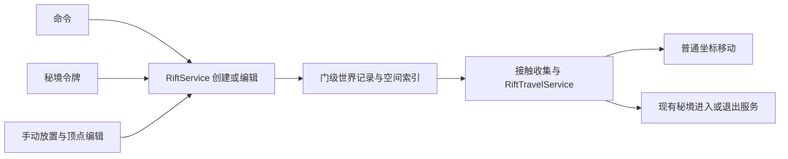

# 裂隙传送门重设计

## 1. 基准与结论

**状态：设计提案，尚未实现。** 本轮只写设计，现有裂隙、令牌、存档、命令与渲染行为均未改动。

基准为当前工作区的 `RiftBlock`、`RiftBlockEntity`、`RiftComponent`、`RiftAnchorItem`、`RiftTeleportService`、`SecretRealmService`、`SecretRealmTokenItem`、`WorldEffects`，以及 Minecraft 26.1.2 / NeoForge 26.1.2.99 的 patched sources。此前实现记录见 [裂缝渲染实现](裂缝渲染实现.md)，通用渲染能力见 [100](100_世界特效渲染管线设计.md)，秘境规则以当前代码为准。

用户明确的要求：

1. 用**自由放置的顶点**捏形状；只需支持平面，不做曲面。
2. 轮廓能与方块建筑契合。
3. 命令、秘境令牌、手动放置均可创建传送门；可设置包含维度和坐标的目的地。
4. 外观看起来是传送门或空间裂隙。
5. 编辑过程应有充分的调整工具，不限于依次放顶点；支持快速造型、局部修改、整体变换、精确对齐与复用。
6. 召唤门支持配置存续时间，**默认永久保留**；这是门的持续时间，不是令牌物品或秘境实例的寿命。
7. 设计、编辑与导出统一要求 **2 级及以上 OP 权限**；配套导出到数据包的流程，方便制作秘境场景。

推荐模型：**一扇门是一条世界记录，拥有一个平面多边形、一个目的地与一份外观参数。** 顶点编辑、召唤入口和视觉风格改变这些数据，不另建传送实现。门面不占据整格方块，服务端与客户端共用几何算法，通过公开事件与原版传送 API 工作。

玩家侧采用轻量的世界内编辑器：轮廓、变换、对齐、样式、目标与蓝图各有明确工具，共用选区、草稿、历史记录与提交服务。工具可以在同一物品的工具栏切换，也可由内容包提供独立工具载体；不把每一种编辑动作做成另一套门。

第一版支持任意朝向的平面、可凹的单个封闭轮廓、双面可见与双向接触触发；不支持自交、曲面或带内洞的轮廓。这里的“双向”指从门的正反面均可进入，不表示自动生成另一扇门。

## 2. 现状为什么需要换模型

| 当前事实 | 对新需求的影响 | 新方案 |
| --- | --- | --- |
| 每格裂隙是独立方块实体，只存目标维度与颜色 | 不能描述整扇门及精确落点，逐格改目标容易遗漏 | 门级记录统一保存形状和目的地 |
| 扫 26 邻域连线，三点成环就填三角形 | 邻近门会混连，凹口和空白会被意外填满，难以贴合建筑 | 显式平面与封闭顶点轮廓，不按空间邻近猜连接 |
| 实体进入整格方块就触发 | 显示区域与传送区域不一致 | 对实际门面进行精确窄相检测 |
| 按维度比例换算落点，并搜索或创建回程裂隙 | 不符合“指定维度和坐标”，只按来源维度也不足以正确配对 | 精确坐标目的地；回程策略单独声明 |
| 秘境令牌直接 `SecretRealmService.enter/exit` | 令牌目前不会召唤门，普通裂隙又不会结算秘境成员 | 令牌创建门，进入门后仍调用同一份秘境服务 |
| 每个可见裂隙每帧扫描邻居并生成几何 | 大门的成本随方块数及邻接密度增长 | 形状修订时生成缓存，逐帧只剔除、上传参数与绘制 |
| 通用阶段任务目前只在透明粒子之后执行 | 把不透明门面直接放在这里，会盖掉门前未写深度的透明物体 | 通用管线增加不透明表面阶段，再执行原有透明阶段 |

原版 `Portal.getPortalDestination` 的契约是返回 `TeleportTransition`，随后由 `Entity.handlePortal` 执行传送。不能在这个查询里调用会自行传送的 `SecretRealmService.enter`，再把结果交回原版，否则会出现副作用与执行职责混用。虚拟门面使用自己的接触收集入口，实际传送仍使用原版 API。

## 3. 一份形状：平面 + 局部二维轮廓

### 3.1 表示与校验

```text
RiftShape
  vertices: List<RiftVertex> // Double-precision u/v pairs forming one simple polygon.

RiftPlacement
  origin: Vec3              // World-space origin, stored as doubles.
  normal: Vec3
  tangent: Vec3

world(u, v) = origin + tangent * u + bitangent * v
bitangent = normal × tangent
```

`normal`、`tangent` 在服务端校验后正交归一化；两端使用同一份确定性的基底构造。顶点使用局部坐标，避免远离世界原点时把大坐标转成 float 造成抖动。渲染时先用 double 减相机位置，再转 float。

轮廓可自由拉成拱形、菱形、折线裂缝或不规则洞口，凹多边形也成立。圆形、圆弧和 Bézier 曲线工具最终都生成平面内顶点，不需要另一种“曲线门”实现。方向反转只改变轮廓绕序，不改变填充区域。

保存前统一检查：数值有限；至少 3 个有效顶点；无重复边、零长边、自交或重叠边；面积不接近零；大小与顶点数量不超限。连续共线的中间点可在保留轮廓的前提下归一化；无效草稿保留在编辑器，不发布为可通行的门。

建议默认上限为 **128 个顶点、局部两轴各 32 格**，在服务端集中配置，并设置经过验证的硬上限。128 点的简单多边形最多产生 126 个三角形。这是成本边界的初值，不是编辑工具的固定步长；界面提前显示当前用量和上限，不能超限后偷偷截断轮廓。

### 3.2 编辑与方块契合

裂隙锚作为编辑入口，打开工具栏与当前选中门的属性；具体调整分为轮廓、变换、对齐、样式、目标与蓝图工具。AUI 负责工具栏、轮廓的正视图与数值面板，世界里显示实际大小的点、边、控制柄与预览。

1. **确定平面**：点方块面时默认采用该面的平面；需要倾斜门时，用三个不共线的空间点确定平面。平面确定后，后续顶点都由视线与该平面的交点生成，不会悄悄变成曲面。
2. **生成轮廓**：可逐点绘制，也可从矩形、椭圆、多边形、拱门或裂缝生成器起步；所有结果均可继续改点和边。
3. **局部与整体调整**：点、边、整面分别选择；用控制柄拖拽，或在数值面板输入长度、角度、坐标。可框选多个点统一移动、对齐或缩放。
4. **吸附**：可切换自由坐标、整格、半格、1/16 格或自定义间距，同时允许吸附到方块面、棱角、边中点与已有顶点。吸附候选仍投影回当前平面，超过阈值就不吸附。
5. **确认**：服务端校验并一次替换整份形状，旧版本继续工作直到新版本通过。操作中可随时撤销、重做或取消草稿，不能把一半的拖拽结果发布成可通行门。

半砖的半高、楼梯的阶梯轮廓可通过吸附后的折线顶点贴合。门面是独立几何，可以经过同一个方块格中的空余空间，不要求用 `mxt:rift` 替换那一格，所以不会挤掉楼梯、半砖、墙和门框。

平面位置可微调，贴面预览使用很小的显示偏移避免 z-fighting；视觉偏移不应变成传送判定的另一套平面。普通墙体继续按场景深度遮挡门面；本方案不修改方块碰撞或挖空墙壁。复杂模组模型若没有可用的碰撞特征，仍可自由放点，不承诺从其渲染模型自动提取所有棱线。

贴合建筑采用主动工具：拾取方块特征、把指定边对齐到命中边、将整扇门贴到选定面，以及沿法线微调间距。不会在每 tick 扫描门框或重裁轮廓。建筑改变后，可再次使用工具调整；可见遮挡仍随世界正常更新。

### 3.3 唯一几何出口

`RiftGeometry` 是纯数据算法：归一化轮廓、点/边/区域测试、三角化、包围盒与相交计算共用一处。简单凹多边形采用带退化校验的耳切法；最多 128 点，重建期的二次复杂度可以接受，不在每帧运行。

三角化失败返回结果，不偷偷改成凸包，因为凸包会把玩家刻意留下的凹口填满。碰撞判定读取相同轮廓或由它生成的三角形；亮边噪声、粒子和距离场不参与决定可传送区域。相邻两扇门只看各自身份，既不会自动合并，也不会跨门连线。

### 3.4 编辑工具清单

工具是对同一草稿的不同操作视图。下表是目标能力清单，不代表当前代码已有这些功能，也不要求每个工具单独注册一件本体物品。

| 工具 | 能做什么 | 具体规则 |
| --- | --- | --- |
| 选择 | 点选顶点、边、整门；框选、追加/排除选区、全选 | 屏幕距离决定选点容差，不随世界距离变成难以点击的小目标；背面同样可编辑 |
| 轮廓笔 | 加点、闭合、在边上插点、删除点、移动点或整条边 | 拖边默认移动其两个端点；删除后必须仍有有效闭合轮廓才能应用 |
| 基本形状 | 矩形、圆角矩形、椭圆、正多边形、拱门、狭长裂缝 | 宽高、角数、拱高与裂缝起伏可调；随机轮廓有固定 seed，拖动或重开面板不重新抽样 |
| 曲线 | 以圆弧或二次/三次 Bézier 段替换指定边，拖动控制柄调弯曲程度 | 控制柄始终位于工作平面；可将曲线烘焙成普通顶点后逐点修改 |
| 顶点整理 | 插入等距点、倒角、局部圆角、合并近点、简化轮廓 | 以误差约束简化，保留选中的尖角与受保护点；不能跨过狭窄凹口或制造自交 |
| 边调整 | 沿边法线平移、延长/缩短、平面内向外拉出一段、整体内缩/外扩 | 拉出生成新边与顶点，保持封闭；内缩/外扩若产生自交、孔洞或多片结果，预览标错并拒绝应用 |
| 变换 | 整体或选区平移、旋转、等比/非等比缩放、平面内剪切与镜像 | 可切换世界轴与局部轴；数值输入与控制柄操作执行同一变换 |
| 对齐 | 点共线、水平/垂直、等距分布、左右/上下对称、按边对齐 | 约束相对于工作平面；先对选区计算完整结果，再统一验证，不逐点发布 |
| 贴合 | 吸附到方块特征、整面贴到命中面、法线方向推近/拉远 | 贴合整门时用刚性变换保留轮廓；不把非共面方块特征强行变成曲面 |
| 样式 | 颜色、内部图案、流速、亮边宽度、柔光强度、粒子密度 | 只改外观，随时可回到轮廓编辑；面板显示增强开关及实际可用的基础效果 |
| 目标记录 | 记录站立点或选中的安全落点，编辑维度/坐标/朝向，将目标应用到门 | 记录点以实体脚底中心解释；任意输入与实际提交仍受服务端权限控制 |
| 蓝图 | 保存、读取、复制形状与样式，生成镜像副本或重复放置 | 粘贴先成为可调整预览，确认后创建新门身份；目的地是否复制由用户明确选择 |

整个门的三维平移/旋转改变 `RiftPlacement`，点、边及选区调整只修改局部二维坐标。改变工作平面时，提供“保持形状并把整门转过去”和“保持当前世界位置不变”的明确选择；后一种只允许重新选择同一几何平面的基底，不能将非共面顶点悄悄压扁。

旋转与缩放支持包围盒中心、面积重心、指定顶点或自定义枢轴。枢轴只是编辑状态，切换枢轴不能让门跳位置。把原点重新设置到枢轴时必须反向补偿局部坐标，保证世界顶点、UV 图案位置与传送面不变。

默认缩放以枢轴和拖拽开始时的完整快照计算，不逐帧累乘，避免拖拽越久误差越大。零比例或接近退化的缩放不可应用；镜像由显式工具执行，统一校正绕序，普通缩放不在拖过零点时突然翻面。

内缩、外扩、圆角等复杂几何工具可先单独实现，不阻塞选择、自由轮廓、移动/旋转/缩放和吸附的基础编辑闭环。它们不扩张“单个平面、单一轮廓”的数据语义；遇到当前模型表达不了的结果明确提示，不用取凸包或保留最大碎片替用户作决定。

### 3.5 精确编辑、吸附与操作体验

编辑界面采用“左侧工具、右侧属性、底部状态”的轻量布局，并允许切换到沿门法线观察的二维正视画布。世界预览显示与建筑的位置关系，二维画布便于调整窄裂缝与遮挡中的顶点；两者操作同一个选区和草稿，不保存两份形状。

- **可见反馈**：当前平面显示坐标网格与局部轴；选中边显示长度，关键点显示局部/世界坐标；底部显示面积、宽高、顶点预算、目的地状态与错误位置。无效轮廓高亮出相交的具体边，仍可继续编辑。
- **受限拖拽**：点和边始终锁在平面内；整体移动可锁局部 u/v、世界轴或法线，旋转可输入角度或使用固定角度步进。推近/拉远门面是一项实际位置调整，与渲染抗重叠偏移分开。
- **吸附优先级**：先遵守显式轴锁，再在兼容约束的候选中选择；临时指定的参考点、现有选定顶点、方块特征、网格依次比较。以屏幕距离阈值进入吸附、稍大的阈值退出，避免拖动时在邻近点之间闪跳；显示当前吸到哪个特征。
- **对称编辑**：可设置一条局部对称轴并关联两侧选区，拖动一侧时同步另一侧；轴上的点只沿轴移动。它是编辑辅助关系，最终保存的仍是普通顶点，不在服务端 tick 持续求约束。
- **视线退化**：相机视线接近平行工作平面或交点过远时停止新增点并提示改视角，也可切到二维画布；不能把数值不稳定的远处交点当作一次有效拖拽。
- **输入焦点**：数值框取得焦点时不同时触发世界点击和工具快捷操作；明确切换相机观察与鼠标编辑。取消当前工具、撤销本次拖拽、退出整场编辑是三个不同动作，避免一次取消就丢掉全部草稿。

快捷操作只在编辑会话内生效，既可从工具栏使用，也可配置按键，不为每个工具强占全局快捷键。会话不暂停服务端世界；编辑原门时清楚区分仍在运行的旧门与仅自己可见的草稿，启停原门使用独立按钮。

### 3.6 曲线、蓝图与历史记录

曲线只存在于**平面轮廓**上，不引入弯曲门面。编辑时可保留控制柄，提交时按固定世界误差自适应采样，再走统一多边形校验。采样精度不依赖相机距离或帧率，不能让站远一点就改变传送区域。采样超出顶点预算时要求调整精度或简化，不静默截断。

门记录的权威形状仍为烘焙后的顶点；编辑过的点再次打开时不保证还原原曲线控制柄。若后续要持久化参数化编辑历史，必须另行设计与顶点版本的一致性，不能现在就存两份可独立生效的形状。基础形状生成器的参数也遵守同样规则。

蓝图保存局部轮廓与样式，可附相对原点/朝向的放置偏好；需要带目标时明确勾选。它不复制门 UUID、主人、秘境实例绑定、已过去的到期时间或任何旅行成员状态。复制秘境目的地只带定义引用，新的门按规则重新解析实例；普通坐标目标明确提示是保留绝对坐标，不随门镜像或平移自动改写。

蓝图可以保存在工具载体上，也可导出为预设或完整布局 JSON；完整布局可直接接入秘境定义，详见 §6.6。游戏不直接修改服务器的数据包文件或自动重载注册表。放置时支持连续复制，但每一次确认都经过门数量、局部密度与权限检查。

编辑会话统一持有门 id/基础修订、草稿、选区、工具状态、枢轴、吸附设置与撤销栈。一次拖拽从按下到松开只记为一条历史；形状、变换、样式和目的地修改均可撤销/重做，记录数量与字节数同时设限。

所有工具先生成对同一草稿的编辑操作，预览、数值输入、快捷键和命令复用操作实现；提交仍只发送有界的完整快照，不让网络依赖客户端的撤销栈。服务端按基础修订比较后一次应用；冲突时保留本地草稿，并允许重新读取、另存蓝图或创建副本，不自动覆盖别人的编辑。

编辑本身不占有全局渲染状态，不创建每个工具各自的线程和同步队列。取消、离线、换维度或工具被移除时结束会话并清掉预览；断线前未提交的临时预览不能被当成已经保存的世界门。

### 3.7 AUI 编辑与配置 GUI

GUI 是与世界工具等价的完整入口，拥有 2 级及以上 OP 权限的玩家可以在界面里新建、改形状、填坐标、调外观和保存蓝图，不要求先记住所有物品操作。手持工具对门使用、工具的新建按钮和 `/mxt rift edit` 都进入同一会话，并使用同一服务端权限检查。

布局示意：

```text
┌──────────────────────────────────────────────────────────────────────┐
│ 裂隙编辑器   新建 / 已选门   未应用更改      撤销  重做  帮助          │
├──────────┬────────────────────────────┬──────────────────────────────┤
│ 选择     │ 正视画布 / 世界预览        │ 形状  位置  目的地  外观  蓝图 │
│ 轮廓笔   │                            │                              │
│ 基本形状 │     网格、轮廓与控制柄     │ 当前工具参数或所选对象属性    │
│ 曲线     │     选区、尺寸与参考线     │ 数值输入 / 预设 / 操作按钮    │
│ 变换     │                            │                              │
│ 对齐     │                            │ 错误说明与相关顶点/边定位     │
├──────────┴────────────────────────────┴──────────────────────────────┤
│ 局部/世界轴   枢轴   吸附/步长   宽高/面积/点数   校验状态           │
├──────────────────────────────────────────────────────────────────────┤
│ 还原草稿                 保存蓝图           取消           应用       │
└──────────────────────────────────────────────────────────────────────┘
```

工具栏与底部操作固定，属性区独立滚动。空间不足时工具缩为图标、属性区折叠为抽屉或独立页，不把确认按钮挤出屏幕；所有图标有可见名称或按需说明，纯键盘也能切换页签、填写数值和应用。

中心画布默认沿工作平面正视，支持缩放、平移、框选、显示/隐藏网格、适应全部轮廓、聚焦选区和重置视图。画布坐标是世界长度单位；显示缩放只改变观察，不改变形状大小和曲线采样精度。可通过顶点表直接填写局部 u/v，选中表格行同步高亮画布中的点，便于精确制作非规则门。

“世界预览”切到原世界中的轻量工具叠加，保留当前草稿、工具和选区，可绕门走动看正反面、检查与建筑是否贴合；返回面板不丢编辑进度。第一版复用正常世界渲染，不为 GUI 再启动一份世界、远端维度相机或门户递归渲染。相机观察和拖拽工具分别接管输入，不能一次鼠标移动既转视角又拖顶点。

| 属性页 | 可配置内容 | 反馈与约束 |
| --- | --- | --- |
| 形状 | 生成器类型与尺寸、顶点表、曲线/精修参数、选区操作 | 立即预览；标出自交与退化边；显示烘焙后的顶点预算 |
| 位置 | 来源维度摘要、世界原点、平面方向、局部朝向、枢轴、移动/旋转/缩放 | 整门的来源维度沿用当前编辑世界，跨维度放置通过蓝图在另一世界创建；重设原点不改变实际形状 |
| 目的地 | `position` / `secret_realm` / `return`、可搜索的维度或定义、x/y/z、可选 yaw/pitch、`exact` / `nearby` | 按目标类型显示相关字段；“记录当前位置”“从记录载入”减少手填；无目标时不可启用通行 |
| 外观 | 风格、颜色、纹理变换、流速、亮边、柔光、粒子、预览时间的播放/暂停 | 暂停只冻结自己的外观预览；恢复或应用不暂停世界与其他观察者的动画；可单独还原某组参数 |
| 蓝图与导出 | 保存/载入、形状/样式/目标复制范围、镜像副本、单门/选区布局导出、JSON 导入与文件保存 | 选择形状预设或秘境布局格式、坐标基准和目标引用方式，导出前预览结果；导入先改草稿，不自动发布 |

门级属性区显示启停、持续时间、剩余时间和手动删除。持续时间提供“永久”开关与 tick 输入（可辅助换算秒），默认勾选永久；设为有限时长时清楚显示“从本次明确设置生效时开始计时”。修改几何/外观不会重置剩余时间。删除需对明确选中的门操作；取消草稿不能删除已存在的门。界面显示当前选中门的短身份、来源维度与已绑定秘境摘要，避免同时编辑多扇门时改错对象。

目的地状态分为“格式有效”“维度/定义可解析”“落点尚未实测”等，编辑器不为一个看起来绿色的勾每帧加载远处区块。可提供显式的“检查落点”按钮，走有次数/距离/权限限制的服务端请求；结果带门草稿版本与实体尺寸摘要，修改目标或实体姿态后失效。检查成功也只是该次快照，正式传送仍复验；秘境定义的检查不提前创建实例或占名额。

“应用”一次提交形状、位置、目标与外观的有效快照；服务端确认成功后更新基础修订并保留当前工具。失败保留草稿，定位具体字段或边；修订冲突显示重新载入、另存蓝图或复制新门的选择。校验提示显示在对应区域，避免每拖一个点就弹窗。新建门只有应用成功才出现在服务端世界，旧门在此之前保持已发布状态。

GUI 页面与世界工具共用一个会话模型，AUI 只绑定属性与编辑操作，不直接改世界附件或 GPU 缓存。布局折叠、网格显示和画布视图属于客户端偏好；形状、目标、外观与启停属于服务端门数据，不把玩家自己的面板布局同步给其他人。

## 4. 门级世界记录与生命周期

```text
RiftRecord
  id: UUID
  revision: long
  placement: RiftPlacement
  shape: RiftShape
  destination: RiftDestination
  appearance: RiftAppearance
  enabled: boolean
  durationTicks: long        // Configured lifetime; zero means permanent.
  expiresAt: optional long
  owner: optional UUID
  boundRealmInstance: optional instance identity
```

每个维度一份 `RiftWorldAttachment` 保存该维度的门记录；运行时的区块/section 索引、接触候选、等待传送和渲染缓存都是派生数据，不重复持久化。创建、编辑、启停与移除只经过一个 `RiftService`，统一更新附件、索引、修订号与同步。

手动、命令与令牌创建共用 `duration_ticks` 语义：非负整数，**缺省或 0 为永久保留**，正数为门创建后存续的 tick 数。配置的持续时间与实际截止时刻分别保存，导出使用前者；`expiresAt` 由服务端统一时钟计算，正数范围与相加溢出在发布前校验。令牌组件中的同名配置只控制它召唤的门，不能混用 `SecretRealm.duration_ticks` 的秘境实例时限。

永久门仍可手动关闭或删除；关闭只停止通行，删除才移除记录。有限门关闭期间继续计时，几何、样式、目的地修改和重复使用令牌不自动续期；只有明确修改持续时间/续期操作才从该次服务端生效时重新计算截止时刻。切换为永久时取消原到期任务。

计时使用服务端游戏 tick，不按现实时间推进：正常停服期间不消耗剩余 tick，跨重启保留截止状态。到期调度接入 `util.dispatcher`，不逐门装一份 tick 计数器。区块未加载不强加载；重新关注或触发前也检查过期时间，防止延迟执行的过期任务让门继续通行。门到期只移除门、取消其未完成的进入请求并同步消失，不删除秘境，也不把已进入的成员强制送出。

门可以跨区块。记录不寄存在门中心那一格的方块实体中，因此边缘区块仍被玩家加载时，不会因“中心区块卸载”让整扇门消失。按形状包围盒建立保守索引，精确测试再排除空白；不因建立索引而生成区块。

`owner` 记录创建者，不授予低权限玩家编辑资格，也不阻止拥有 2 级 OP 权限的管理员编辑其他人的门。谁可以穿门与编辑权限分开，秘境自身的进入条件照常生效。传送门不靠 GC、弱引用或客户端对象维持存在，换世界与服务端关闭时显式释放运行时状态。

## 5. 三种目的地，共用一个进入入口

| 目的地 | 保存内容 | 执行规则 |
| --- | --- | --- |
| `position` | 维度键、精确 `Vec3`、可选 yaw/pitch、落点策略 | 同维度和跨维度同样支持；不做坐标比例换算 |
| `secret_realm` | 秘境定义引用；运行中可绑定具体实例身份 | 继续由 `SecretRealmService` 检查条件、选择/唤醒/创建实例、记成员和触发行为 |
| `return` | 无固定世界坐标 | 读取进入者自己的秘境旅行记录，通过 `SecretRealmService.exit` 返回 |

三种目的地是同一个封闭数据类型的分支，先不增加一套目的地插件注册框架。`RiftTravelService.tryEnter(record, entity)` 统一做门状态、实体资格、冷却、目标解析与实际执行，返回现有 `Result` 体系中的结果与真正到达的实体。

### 5.1 普通坐标落点

坐标始终表示实体脚底中心，不是方块坐标，也不是以来源为基准的偏移。未填写朝向时保留进入者角度；默认清零速度，避免把高速移动带到一个普通坐标目的地。

落点策略只有两个：

- **`exact`，默认**：在给定坐标检查实际实体尺寸、建筑高度、世界边界、碰撞和危险环境；不成立就留在原处并返回明确失败，不改坐标、不挖空间。
- **`nearby`，显式选择**：在有上限的局部范围内按确定性顺序寻找安全位置，结果必须报告实际落点；范围内没有就失败。与 `exact` 共用安全检查。

检查使用整个实体包围盒及其支撑情况，不能沿用当前“只检查脚下一格”的逻辑。飞行、掉落物与地面生物采用各自适用的支撑规则；液体/危险方块的拒绝规则在同一落点服务内处理。禁止用统一的 600 tick 缓降掩盖无落脚点的结果。

维度不存在时拒绝。普通已加载维度里的目标区块尚未就绪时，使用公开的区块 ticket 与异步加载入口等待；不在 tick 中 `join()`。ticket 按任务和区块引用计数，避免一项传送结束时移除其他项还在使用的 ticket。完成回到服务端线程，再检查实体、门修订、距离与目标安全；等待超时、玩家离开、门关闭都释放 ticket。源端不冻结玩家，离开门后取消等待。

休眠秘境的重新打开由秘境服务负责，不能把任意不存在的维度 id 当成“自动创建一个世界”。实际传送仍可能被 NeoForge 拒绝，只有取得非空的返回实体后才视为成功。

### 5.2 进入秘境与共享实例

令牌召出的门第一次成功进入时，由现有秘境分配逻辑选择实例，然后把实例身份绑定到门记录。之后所有人只尝试进入这份实例：满员就拒绝，不把队伍余下的人送入另一份实例。服务端串行处理首次绑定；等待加载的多个进入请求也必须共用该次解析，不能各自创建一份实例。

在 `SecretRealmService` 内补充“进入指定实例”的入口，与现有 `enter` 共用检查和执行逻辑。实例身份包含定义与序号等稳定信息，不能只存一个可能被复用的维度字符串。实例到期或被删除时，原门进入失效状态；需重新召唤或明确重置绑定，不在背后换一份地图。

创建门本身不占成员名额、不产生 `EnterPost`、不认领实例。条件、`EnterPre`、人数、实例数、认领与 `enter_action` 都在真正进入时处理。实例创建/唤醒可以在传送前发生，但移动失败不能留下虚假成员；新建且无人成功进入的实例需要走已有收尾规则清理。

回程门采用 `return`，每位进入者回到自己的来源，而不是回到第一个使用令牌的玩家那里。无有效旅行记录的人使用回程门会收到失败。保存来源时使用门外的安全退出点，避免退出后刚好站在原门触发区域中。

直接写坐标也不能绕过秘境：目标属于本模组创建的实例维度时，进入指定实例仍经过秘境服务；已有成员在自己实例内改位置只进行内部移动；离开自己的实例时仍执行退出条件和成员收尾。第一版保持现有“不嵌套进入另一秘境”的限制。

`mxt:existing` 指向普通公共维度时，不把整个维度强行当成私有秘境：显式的 `secret_realm` 路由才取得成员身份。当前已有成员的跨维度离开仍需正确结算。以上扩展放进秘境服务的共用移动流程，不能先 `exit()` 传一次，再为坐标目的地传第二次。

## 6. 三个创建入口与手动配置

### 6.1 统一创建请求



可复用预设使用一份新的 `mxt:rift` 数据包定义，放在 `data/<namespace>/mxt/rift/<path>.json`：保存局部顶点与外观默认值，不保存某位玩家的实例成员状态。它与现有同名物品组件属于不同注册表，不混淆载荷。

手动捏出的门不要求先写 JSON。新门将预设或编辑草稿解析为自己的形状与外观快照，后续编辑互不影响；失去预设也不抹掉已经搭好的门。颜色继续支持自动取色与覆盖，自动颜色由目的地身份稳定派生。

### 6.2 命令形状

下面是**拟议命令树**，当前代码还不支持：

```text
/mxt rift spawn <preset> <origin> <facing> position <dimension> <x y z>
/mxt rift spawn <preset> <origin> <facing> secret_realm <definition>
/mxt rift target <id> position <dimension> <x y z>
/mxt rift target <id> secret_realm <definition>
/mxt rift target <id> return
/mxt rift edit <id>
/mxt rift transform <id> ...
/mxt rift copy <id> <origin>
/mxt rift duration <id> <ticks>
/mxt rift export <id> preset|layout
/mxt rift info <id>
/mxt rift remove <id>
```

`facing` 为常见轴向放置的快捷参数，任意斜面通过编辑器设置。其他可选参数包括精确朝向、落点策略、颜色与持续时间，不在一条命令里强塞全部顶点。坐标可用原版相对坐标语法，但保存前转换为指定命令上下文下的绝对坐标。

管理员命令沿用现有 `ServerCommandManager.mayChange` 的 gamemaster 权限，对应 **2 级及以上 OP**；工具、GUI、编辑快照与导出请求使用同一语义。定义参数走原版 `ResourceArgument`，维度参数走原版维度参数，不手写补全。选中门后可省去反复手填 UUID，命令执行端仍需解析到唯一门记录。

`transform` 提供数值形式的移动、旋转、缩放与镜像，`copy` 创建独立的新门。命令与控制柄调用相同的编辑操作，不能在命令里再实现一套坐标与基底计算；复制也遵守蓝图的目的地选择与实例身份清理规则。

`duration <ticks>` 中 0 为永久，正数从命令生效时开始计时；`export` 与 GUI 共用序列化入口。批量布局在 GUI 选择范围和参考点，命令可以导出单门，避免把所有布局参数塞进一条命令。

### 6.3 秘境令牌

令牌绑定的秘境定义不变；右键改为请求召唤一扇通往该秘境的门，进入门才开始旅行。在秘境里使用则召唤 `return` 门，依然遵守主动退出条件。默认使用绑定预设，允许组件选择其他形状与外观；没有足够空间或放置面无效时返回失败，不把门塞进玩家身体里。

**令牌从“直接传送”改成“召唤门”是提案中的行为变更。** 一枚令牌的再次使用优先定位并复用其仍有效的召唤门，不无限创建重复门；过期、失效或不在当前世界的门才重新创建。召唤门支持配置 `duration_ticks`，缺省为 0（永久），不会因再次使用而自动续期；令牌沿用现有不消耗的行为。

普通玩家可以按玩法使用已经配置好的令牌召门和穿门；这不授予其打开编辑器、改时长/目标或导出的权限。数据包和服务端提供的召唤配置由服务端读取，不能让低权限客户端临时传一套任意配置。

### 6.4 手动放置与目的地面板

保留裂隙物品的“放一扇门”入口，裂隙锚打开完整编辑器；轮廓、变换、样式、目标记录等工具共用当前会话。内容包若希望把它们表现成独立物品，只为载体指定工具能力与初始模式，不复制选区、历史记录或服务实现。放置整扇预设门和逐点画门最后都生成同一种记录，不逐顶点放方块实体。

AUI 目的地面板允许选维度、填 x/y/z、可选 yaw/pitch，并显示目标类型与落点策略；也可潜行记录当前位置，再对门应用。数字输入校验有限值、范围和维度存在性，点击应用后由服务端再次验证。未绑定目的地的草稿显示编辑预览，不能意外默认通向主世界。

目前编辑权限统一为 **2 级及以上 OP**：手动创建、轮廓/位置/外观/目标/时长修改、复制、启停、删除、蓝图导入和导出均检查同一权限。拥有工具、创造模式或是门的创建者都不能绕过检查；持有权限的 OP 可编辑场景中其他人创建的门。记录位置供编辑器使用也遵守该权限。

服务端在打开会话、请求编辑数据、提交修改/导出时分别复验权限、来源世界、有效距离与修订号；玩家会话中被撤销 OP 时，后续操作拒绝并关闭会话。正常通行和使用已配置令牌不要求 OP，秘境条件和各自玩法校验仍然生效。

### 6.5 三种操作示例

| 场景 | 操作流程 |
| --- | --- |
| 嵌进楼梯与半砖搭成的拱门 | 选门框所在平面 → 用拱门生成器起形 → 开启方块特征吸附 → 调整拱顶与底边顶点 → 法线方向微调门面 → 记录并应用目的地 |
| 悬空的狭长空间裂缝 | 三点确定斜面 → 生成带固定 seed 的裂缝轮廓 → 框选中段拉宽、两端收尖 → 平面内剪切和整体旋转 → 调亮边、流速与柔光 → 保存蓝图 |
| 沿建筑两侧放对称的门 | 选中既有门 → 复制形状与样式 → 镜像轮廓 → 枢轴切到建筑参考点 → 吸附对齐后放置 → 单独设置新门目的地 |

这些流程只组合通用工具，不为拱门、裂缝或镜像门写独立生成与传送逻辑。

### 6.6 导出与秘境场景制作

导出是配套能力，统一要求 2 级及以上 OP 权限。GUI 的“蓝图与导出”页和 `/mxt rift export` 共用同一套 Codec 与校验，提供两种明确格式：

| 格式 | 内容 | 用途 |
| --- | --- | --- |
| 形状预设 `preset` | 局部顶点、外观与预设默认参数，不带世界放置位置或具体旅行状态 | 保存为 `data/<namespace>/mxt/rift/<path>.json`，供命令、令牌与工具复用 |
| 完整布局 `layout` | 一扇或多扇门的形状、位置/平面基底、目的地、外观、启用状态与配置的持续时间 | 导出为秘境定义的 `portals` 字段片段，随场景复建门 |

蓝图工具选定单门或框选一个空间范围，GUI 列出待导出的门，允许勾选、聚焦、剔除和排序，并预览最终 JSON。默认导出服务端已经应用的版本；导出本地草稿时明确标记，仍需经过同样的服务端授权和数据校验，不为了导出而自动把草稿应用到世界。

结果支持复制 JSON 到剪贴板或显式保存到客户端文件，默认位于游戏目录的 `exports/mxt/rifts/`；已有同名文件不静默覆盖。远程服务器把授权后的结果发给执行者，由客户端处理复制或保存，不写客户端给出的服务器路径，也不改动已安装的数据包。无玩家的命令源可以取得 JSON 文本，不要求存在客户端 GUI。

#### 坐标与引用

完整布局的来源维度由加载它的秘境实例决定，不能写死设计世界的维度或某次生成的 `secret_realm/.../<序号>`。门在实例内的摆放有两种基准：

- **秘境坐标，默认**：保存当前门的数值坐标，作为新实例内相同位置；不保存设计世界的维度 id。适合直接在对应地形中搭好入口和出口后导出。
- **相对入口**：在 GUI 明确选择作为入口基准的参考点，导出相对位移并设置 `relative_to_entry`；运行时以该实例已确定并持久化的入口锚点还原。预览同时显示参考点和实际位移，不能误用正在编辑门的枢轴。

局部轮廓、平面 normal/tangent 与纹理参考保持一致，采用 double 数值，不四舍五入到整格。两种坐标基准只改变摆放位置的解释，不缩放门。

目的地引用分开处理：`return` 原样导出；`secret_realm` 只保留定义引用，去掉当前绑定实例；`position` 默认保留明确的固定维度/坐标。如果目标指向正在设计的秘境，GUI 可显式选“当前秘境实例”，在**模板目的地**中省略维度，加载时解析为新实例自己的维度。该省略语义只存在于模板，实际 `RiftRecord` 必须拥有解析完成的目标。不得静默把一个固定坐标目标改成局部目标，反过来也一样。

导出不包含运行时门 UUID、修订号、创建者、绑定实例、剩余 tick、截止时刻、成员和冷却等会话状态。持续时间导出配置的 `duration_ticks`，新实例创建门时重新开始计时；0 仍为永久。GUI 给布局条目分配可编辑且组内唯一的 `key`，用于重复导入与实例初始化去重，不沿用世界门 UUID。

#### 秘境定义接入

建议给 `SecretRealm` 增加可选 `portals` 列表，默认 `[]`。每个条目嵌入一份共用的 `RiftTemplate`，加载布局、蓝图和手动创建最终都通过同一份 `RiftService`，不为秘境出口另写一套门。下列是**拟议字段示例，当前代码尚不支持**：

```json
{
  "portals": [
    {
      "key": "exit",
      "placement": {
        "origin": [2.5, 65.0, 4.0],
        "normal": [0.0, 0.0, 1.0],
        "tangent": [1.0, 0.0, 0.0]
      },
      "relative_to_entry": false,
      "shape": {
        "vertices": [[-1.0, 0.0], [1.0, 0.0], [0.75, 2.0], [0.0, 2.5], [-0.75, 2.0]]
      },
      "destination": { "type": "return" },
      "appearance": { "style": "rift" },
      "duration_ticks": 0,
      "enabled": true
    }
  ]
}
```

该对象是合入现有秘境定义的字段片段，**不是缺少 `generation` 也能独立加载的秘境定义**。省略的可选外观参数按统一默认值处理；完整布局导出应保留足以复现当前效果的所有非默认值。

实例首次准备时，在结构与入口锚点就绪后解析并发布布局门，最后才标记为准备完成。所有条目预先校验，`key` 重复、无效形状、超出边界/预算或无法解析目的地时整批拒绝，不静默丢掉一扇出口。分阶段准备的失败重试要按实例身份与条目 key 幂等去重，不能每重试一次就多建一批门。

准备过的认领实例再次打开时读取世界附件中既有门记录，不重新覆盖场景内的编辑结果；已过期的有限门也不能因休眠重开又被自动补出。实例真正删除时，附件与门一起随该实例清理。调整定义里的布局只影响后续新实例，管理员需要时可显式重新导入；不是每次进入都把模板强制刷回。

**原版结构 NBT 不包含这些门记录。** 因此秘境制作者的流程是“搭建筑 → 在世界中编辑门 → 导出 `portals` → 合入秘境定义”，不能只导出建筑 NBT 就宣称出口已经被打包。现有模板维度复制若携带世界附件，需要在恢复已有门和首次布局初始化之间做同样的去重检查，不把相同出口创建两遍。

## 7. 接触判定、冷却与失败

门面没有实体方块，因此不依赖 `RiftBlock.entityInside`。生物的接触收集接现有 `EntityTickStages`，其他实体使用公开实体 tick 事件并排除生物，避免重复检测；维度 tick 结束时统一执行请求，避免在遍历方块效果或实体列表中途更换世界。

1. 根据实体当前包围盒查询 section 空间索引；该维度没有门时立即返回。
2. 宽相仅取少量邻近门，窄相计算实体 AABB 与实际多边形薄棱柱相交。斜面不能只判断门的世界 AABB，否则四角空白也会传送。
3. 同一实体一 tick 只选一扇门，连续移动优先取最早交点，同时接触则按距离与稳定 id 排序；移动前再次检查门版本与实体状态。
4. 通过 `canUsePortal` 等资格检查，复制原版入口需要的维度准入检查，不因为手动调用 `teleport` 就漏掉它们。
5. 执行所选目的地，结果统一反馈。正常拒绝不写异常日志；连续站在失败门中不逐 tick 发提示或重复发起加载。

判定厚度只用于接触容差，不取客户端的“亮边宽度”或旧“裂隙粗细”。门框、凹口以及没有三角形覆盖的区域不触发。检测过程中不加载源端未知区块。

为避免高速直线跨过薄面漏检，可在同世界、连续实体状态下，对前后 AABB 的移动段进行连续检测，按最早交点选门。换维度、传送事件、实体重建或不连续大位移时清除历史。只有 tick 前后样本无法恢复所有模组在一 tick 中的折线路径与直接 `setPos`，这部分不能宣称完全精确；第一版应明确以接触检测和可确认的连续移动为边界，不为拦截全部移动增加 MC 注入。

成功后对**返回的实体**设置传送冷却，并要求离开门面接触范围才重新武装，防止到达点在另一门内时来回弹跳。共享状态以实体 UUID 识别，实体重建后不继续持有旧实例；死亡、离线、换世界、移除门均清理等待请求与临时状态。

普通坐标门允许可传送的实体；秘境目的地沿用当前 `LivingEntity` 范围。第一版对带乘客/坐骑的组合返回明确不支持，不自动拆骑乘关系，也不只给主实体记一份秘境成员后把整组带进去。整组传送需要后续有实际需求时增加统一成员计划。

## 8. 外观：同一扇门，两种材质风格

| 层 | 外观 | 与几何的关系 |
| --- | --- | --- |
| 内部 | 深色异空间底，缓慢流动的多层纹理、视差和局部涡流 | 完整覆盖实际多边形，不留下方块网格线 |
| 边缘 | 沿轮廓连续流动的亮边，强度和粗细轻微变化 | 只沿真实外轮廓，三角化的内部边绝不能发亮 |
| 外溢 | 很薄的局部柔光和少量碎屑/吸入粒子 | 有严格外扩范围，计入剔除；关闭也不影响门面 |

`portal` 风格更稳定，内部能量连续流动；`rift` 风格更不规则，沿狭长轮廓出现断续亮边和撕裂纹理。两者只改变材质参数与预设，不拆成两套门系统。亮边的动画不能改变服务端的可通行轮廓，避免“看着开着、实际关着”。

样式工具允许调主色/亮边色、纹理的平移/旋转/缩放、内部流动方向与速度、亮边宽度和脉动、外扩柔光、粒子密度，并提供重置与从另一门拾取样式。参数按支持能力显示，不能把尚未实现的屏幕泛光当成现有选项；内部仍保留足够的不透明覆盖以维持门面的深度语义。

纹理变换独立于门面放置，单纯调整枢轴或重设局部原点时补偿纹理参考，防止几何没动而图案突然跳动。临时材质预览不反复重建轮廓网格，提交后才同步给其他观察者。

门面固定在世界平面上，正反面都可见，不随相机转动；视角变化通过局部 UV、观察方向与分层采样表现内部深度，不能继续只用屏幕投影图案冒充三维层次。此处的异空间纹理不是实时渲染目的地世界；真正的远端世界预览与无缝门户不在第一版范围。

轮廓三角网格与可选的边缘距离纹理在形状修订时计算；距离纹理只是材质辅助，不决定孔洞或传送判定。距离场可在后台对不可变快照构建，回到渲染线程校验世界代次与修订号再上传；编辑过程中先用轻量线框，丢弃已经过时的后台结果。

### 8.1 接入通用管线的必要扩展

将 `EffectDraw` 增加两个明确执行阶段，现有任务默认仍为原来的透明阶段：

| 阶段 | 时点与目标 | 内容 |
| --- | --- | --- |
| `OPAQUE_SURFACE` | `AfterOpaqueFeatures`，当前主颜色与深度目标 | 门内部，关闭混合，启用深度测试及深度写入 |
| `TRANSLUCENT_OVERLAY` | 已有 `AfterTranslucentParticles`，现有粒子目标选择 | 轮廓柔光和其他透明覆盖层，深度测试开启、深度写入关闭 |

原版源码中，`AfterOpaqueFeatures` 位于向独立透明目标复制主深度之前。因此在此写入门面深度，后续玻璃、粒子才有机会正确遮挡于门前或门后。先画本模组不透明任务，再捕获共用的 `OPAQUE` 深度，让现有光束增强也能被门面挡住；这一顺序由同一个协调器保证，不依赖事件监听器注册先后。

首批不透明任务不采样该次 `OPAQUE` 快照，避免“先使用、后捕获”的循环依赖；门内部只需要硬件深度测试。后续确需提前采样的消费者另行声明采样时点，不能把同一深度纹理同时作为采样源与绘制附件。

透明边缘不需要依靠关闭深度测试来“穿墙发光”。基本亮边可直接在不透明材质内部完成；外扩柔光是可关闭的增强，继续接受已有透明排序的近似限制，不承诺解决玻璃交叉等全部情况。

每个阶段都遵守 prepare 在 pass 外、render 在 pass 内，上传、复制、ring 轮换和释放不得塞进已打开的 pass。阶段队列独立消费，帧不能在不透明任务完成后就提前关闭。没有裂隙时不增加 pass；若独立阶段不可用，则在提取时选定公开几何提交入口，用支持深度写入的普通纹理管线绘制同一份基础门面快照，并明确交权，不能两条路径各画一次。事件意外缺失时不在透明阶段末尾补画不透明门面，本帧清理任务并在后续帧降级；未知第三方目标不猜测为主目标。

不增加 Mixin、Accessor、反射、原生 GL 或新的渲染依赖，不关闭或改写别人的 pass。GPU 资源继续由 `ClientRenderResources` 托管；临时目标继续租借已有目标池，不另建一套 FBO 管理。

## 9. 同步、缓存与预算

世界记录同步是服务端权威的；单人也按客户端世界快照处理门记录，不让渲染线程直接读取服务端可变集合。这与 profiler 的单人统计直读不是同一种数据职责。

玩家开始关注与门相交的任一源区块时发送门快照，编辑或状态改变时发带修订号的更新，最后一个相关区块取消关注时移除客户端记录。同一门跨多个区块只计一次，以引用计数避免走过区块边界时闪烁。同步范围使用包含亮边外扩的包围盒，不能只看中心区块。

包包含维度/世界代次、门 id、修订号和有上限的顶点数据；乱序更新、旧维度数据与过大的载荷被拒绝。客户端渲染只需要目的地的显示摘要与颜色，不下发完整服务端成员记录；编辑界面经授权后另取可编辑目标。拖动顶点只更新本地预览，确认才提交，不按鼠标采样频率向所有人发全量顶点。

CPU 缓存键至少包括世界代次、门 id 与修订号；形状、三角化、边缘、包围盒和 GPU 网格一起失效。每帧不扫邻居、不查方块实体、不逐三角形新建 `Vec3` 列表。视锥与距离剔除使用整扇门的包围盒，中心在视锥外而边缘可见时仍要绘制。

预算分别约束：每门顶点/尺寸、每维度门数、每 section 重叠候选数、每玩家待加载传送数、客户端网格和材质纹理总量。创建和编辑在发布前检查几何与局部密度预算，超限返回失败，不能创建后随机漏掉部分门的碰撞。可选边缘纹理预算不足时降级材质，不能改变形状或停掉必要的传送检查。

## 10. 代码落点与旧实现处理

| 落点 | 职责 |
| --- | --- |
| `data/rift/` | 预设定义、形状/目的地/外观的 Codec 与加载期校验 |
| `runtime/rift/` | 唯一几何算法、门记录服务、空间索引、进入与安全落点处理 |
| `attachment/RiftWorldAttachment` | 每维度一份门记录 |
| `command/server/RiftCommand` | 管理员入口，调用共用服务 |
| `screen/` | AUI 工具栏、属性/正视画布、共用选区与历史会话；不成为服务端规则出口 |
| `render/rift/` 与现有 `render/effect/` | 缓存门面、材质与通用阶段扩展 |
| 既有网络登记入口 | 跟踪同步、编辑请求、授权快照 |
| 既有 `SecretRealmService` | 指定实例进入、来源落点、成员与退出流程复用 |
| `SecretRealm.portals` 与实例准备流程 | 使用共用门模板复建布局，在结构/入口就绪后创建，重开实例不重复发布 |
| 共用导出 Codec 与 GUI 导出页 | 形状预设、完整布局及客户端复制/保存；不保存旅行状态 |

本稿不要求提前发布 Java API 或另建一个通用事务框架。服务结果接现有 `Result` / `Failure`，跨模块生命周期用现有 NeoForge 事件。

旧的节点连线算法与新多边形语义不能同时作为两套现行门系统保留。**但当前尚未实施，不删除任何旧类或字段。** 后续实现前需明确旧存档处置：

- 旧方块没有轮廓与精确坐标，无法无损推导成一扇新门；也不能把所有邻近旧方块不分目的地拼成一个多边形。
- 推荐提供管理员显式转换/清理入口；转换预览要求用户选择目标与轮廓，确认后才移除所选旧方块。源区块未加载时不做全世界扫描。
- 旧 `mxt:rift` 物品组件、裂隙方块、客户端粗细配置及旧命令参数均涉及兼容决策，按 `AGENTS.md` 在真正删改前确认，再一次同步测试夹具和中英文使用文档。
- 旧研究稿保留为当前实现的历史记录，新方案落地后再标记被替代，不能仅凭本稿把旧审计项写成已修复。

## 11. 实施顺序与验证

1. **几何与记录**：Codec、自由顶点编辑数据、校验、三角化、空间索引和持久化；先完成可读写的门记录。
2. **传送闭环**：坐标目的地、安全落点、异步区块加载、接触与冷却；扩展秘境共用入口后再接令牌和回程门。
3. **玩家入口与制作流程**：先打通共用会话、AUI 正视画布/属性页/世界预览、选择、轮廓笔、移动/旋转/缩放、吸附与撤销，再接形状生成、曲线、精修、对齐、蓝图与独立工具载体；同时完成 2 级 OP 校验、时长配置、预设/完整布局导出及秘境 `portals` 接入，不把导出留为只有文本没有消费入口的功能。
4. **视觉**：通用不透明阶段、基础门面、动态材质与可选柔光，最后做可用性降级与压力验收。

| 验证范围 | 必测行为 |
| --- | --- |
| 形状 | 凸/凹轮廓、倾斜平面、绕序、远坐标、共线/重复/自交/NaN 拒绝；三角形面积总和等于轮廓面积，凹口不填充 |
| 工具与变换 | 点/边/整面和多选操作、局部/世界轴、枢轴切换与重设原点保持世界顶点/纹理不变、旋转镜像绕序、零比例拒绝、拖拽不累计漂移 |
| 轮廓精修 | 圆弧/Bézier 采样不随相机变化、固定 seed 可复现、尖角保护、拉边后闭合、内缩/外扩产生孔洞或多片时拒绝、预算超限不截断 |
| 编辑会话 | 世界/正视图共用草稿、吸附优先级与迟滞、近乎平行视线、数值输入焦点、一次拖拽一条历史、取消/重做、冲突不覆盖、退出清理 |
| GUI | 不同 GUI 缩放/窗口尺寸下操作区可达、属性区独立滚动、顶点表与画布互选、预览模式切换不丢状态、目标检查不隐式建秘境、失效响应不覆盖新草稿 |
| 蓝图与复制 | 新身份、所有权重新取得、实例绑定不复制、绝对目的地不随变换改写、未选目标时不得继承、参数导出再读取得到相同轮廓 |
| 持续时间 | 缺省/0 永久、正数到期、负数/溢出拒绝、跨重启剩余状态、关闭仍计时、普通编辑/重复用令牌不续期、转永久取消任务、门过期不结束秘境 |
| 编辑权限 | 1 级 OP/普通玩家/仅创造模式拒绝，2 级及以上允许；GUI/命令/物品/导出请求一致；撤权后拒绝；正常令牌使用与穿门不要求 OP |
| 导出与秘境布局 | 单门/多门往返、位置与斜面不失真、绝对/入口相对坐标、固定/当前实例目的地、UUID/成员不导出、持续时间从新建重算、布局初始化失败重试不重复、认领实例重开不覆盖编辑或复活过期门 |
| 方块契合 | 半砖、楼梯、门框吸附；自由点仍在同一平面；不替换原方块；实际遮挡与触发位置一致 |
| 接触 | 正反面、水平门、斜门、门框与凹口不触发；直线高速穿面、瞬移历史清理、重叠门稳定择一 |
| 坐标移动 | 同/跨维度精确落点与角度、完整实体尺寸、无支撑/液体/边界拒绝、局部搜索耗尽不挖地形 |
| 等待与失败 | ticket 共享、就绪后复验、超时/离门/改门取消、NeoForge 拒绝、非玩家重建后使用返回实体 |
| 秘境 | 一扇门绑定一份实例、首次并发等待不重复创建、满员不分流、认领/条件/事件不绕过、回程各自归位、实例失效不换地图 |
| 持久化与同步 | 跨重启、跨区块去重、中心区块卸载、过期、旧修订/旧世界包、无权限/远距离编辑拒绝 |
| 管线 | 门面早于透明绘制、深度先画后捕获、门前粒子保留/门后被挡、仅执行一次、pass 内无上传/fence/释放 |
| 客户端 | 基础/增强、正背面、远距离与近裁剪、斜视、玻璃/水、换世界/重载/窗口改变、shader pack 与资源回收 |
| 性能 | 0/1/多扇门、128 点凹轮廓、局部高重叠、多人关注与编辑、CPU 提取/相交/GPU 时间与缓存峰值分别记录 |

实施时行为变化补 GameTest，纯几何探针与 GPU/客户端验证分开汇报。无头测试不能证明真实材质、透明合成或第三方 shader pack 正确；实机运行按仓库规则授权。

本轮仅完成设计与源码/原版公开入口核对，尚无新实现、行为探针或视觉实跑。门持续时间已确定为可配置、默认永久；编辑与导出权限已确定为 2 级及以上 OP。旧存档转换策略仍待确定，不影响自由平面多边形这一核心模型。实施新增数据字段时同步秘境与预设的中英文文档及测试包，当前不把拟议字段写进玩家文档冒充已可用。

文档本地引用与新增内容的日期约束检查通过，`git diff --check` 通过；`gradlew.bat compileJava compileTestModJava --console=plain` 编译通过。编译只说明当前工作区可编译，不表示本提案已经实现或验证。
