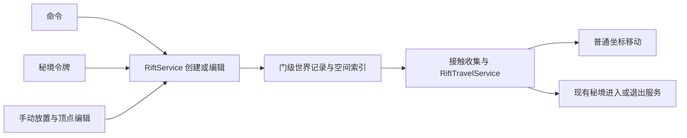

# 裂隙传送门重设计

## 1. 基准与结论

**状态：设计提案，尚未实现。** 本轮只写设计，现有裂隙、令牌、存档、命令与渲染行为均未改动。

基准为当前工作区的 `RiftBlock`、`RiftBlockEntity`、`RiftComponent`、`RiftAnchorItem`、`RiftTeleportService`、`SecretRealmService`、`SecretRealmTokenItem`、`WorldEffects`，以及 Minecraft 26.1.2 / NeoForge 26.1.2.99 的 patched sources。此前实现记录见 [裂缝渲染实现](裂缝渲染实现.md)，通用渲染能力见 [100](100_世界特效渲染管线设计.md)，秘境规则以当前代码为准。

用户明确的要求：

1. 用**自由放置的顶点**捏形状；只需支持平面，不做曲面。
2. 轮廓能与方块建筑契合。
3. 命令、秘境令牌、手动放置均可创建传送门；可设置包含维度和坐标的目的地。
4. 外观看起来是传送门或空间裂隙。

推荐模型：**一扇门是一条世界记录，拥有一个平面多边形、一个目的地与一份外观参数。** 顶点编辑、召唤入口和视觉风格改变这些数据，不另建传送实现。门面不占据整格方块，服务端与客户端共用几何算法，通过公开事件与原版传送 API 工作。

第一版支持任意朝向的平面、可凹的单个封闭轮廓、双面可见与双向接触触发；不支持自交、曲面或带内洞的轮廓。这里的“双向”指从门的正反面均可进入，不表示自动生成另一扇门。

## 2. 现状为什么需要换模型

| 当前事实 | 对新需求的影响 | 新方案 |
| --- | --- | --- |
| 每格裂隙是独立方块实体，只存目标维度与颜色 | 不能描述整扇门及精确落点，逐格改目标容易遗漏 | 门级记录统一保存形状和目的地 |
| 扫 26 邻域连线，三点成环就填三角形 | 邻近门会混连，凹口和空白会被意外填满，难以贴合建筑 | 显式平面与封闭顶点轮廓，不按空间邻近猜连接 |
| 实体进入整格方块就触发 | 显示区域与传送区域不一致 | 对实际门面进行精确窄相检测 |
| 按维度比例换算落点，并搜索或创建回程裂隙 | 不符合“指定维度和坐标”，只按来源维度也不足以正确配对 | 精确坐标目的地；回程策略单独声明 |
| 秘境令牌直接 `SecretRealmService.enter/exit` | 令牌目前不会召唤门，普通裂隙又不会结算秘境成员 | 令牌创建门，进入门后仍调用同一份秘境服务 |
| 每个可见裂隙每帧扫描邻居并生成几何 | 大门的成本随方块数及邻接密度增长 | 形状修订时生成缓存，逐帧只剔除、上传参数与绘制 |
| 通用阶段任务目前只在透明粒子之后执行 | 把不透明门面直接放在这里，会盖掉门前未写深度的透明物体 | 通用管线增加不透明表面阶段，再执行原有透明阶段 |

原版 `Portal.getPortalDestination` 的契约是返回 `TeleportTransition`，随后由 `Entity.handlePortal` 执行传送。不能在这个查询里调用会自行传送的 `SecretRealmService.enter`，再把结果交回原版，否则会出现副作用与执行职责混用。虚拟门面使用自己的接触收集入口，实际传送仍使用原版 API。

## 3. 一份形状：平面 + 局部二维轮廓

### 3.1 表示与校验

```text
RiftShape
  vertices: List<RiftVertex> // Double-precision u/v pairs forming one simple polygon.

RiftPlacement
  origin: Vec3              // World-space origin, stored as doubles.
  normal: Vec3
  tangent: Vec3

world(u, v) = origin + tangent * u + bitangent * v
bitangent = normal × tangent
```

`normal`、`tangent` 在服务端校验后正交归一化；两端使用同一份确定性的基底构造。顶点使用局部坐标，避免远离世界原点时把大坐标转成 float 造成抖动。渲染时先用 double 减相机位置，再转 float。

轮廓可自由拉成拱形、菱形、折线裂缝或不规则洞口，凹多边形也成立。圆形通过顶点近似，不需要一种独立的“圆门”实现。方向反转只改变轮廓绕序，不改变填充区域。

保存前统一检查：数值有限；至少 3 个有效顶点；无重复边、零长边、自交或重叠边；面积不接近零；大小与顶点数量不超限。连续共线的中间点可在保留轮廓的前提下归一化；无效草稿保留在编辑器，不发布为可通行的门。

第一版建议上限为 **128 个顶点、局部两轴各 32 格**。128 点的简单多边形最多产生 126 个三角形。这是成本边界的初值，不是世界观数值，最终通过性能验收确定。

### 3.2 编辑与方块契合

裂隙锚作为放置与调整工具，提供新建、编辑、目的地绑定三个模式；模式与数值面板使用 AUI，世界里的点、边和预览由本模组绘制。

1. **确定平面**：点方块面时默认采用该面的平面；需要倾斜门时，用三个不共线的空间点确定平面。平面确定后，后续顶点都由视线与该平面的交点生成，不会悄悄变成曲面。
2. **画轮廓**：依次加点，闭合后预览填充。可选中顶点移动、在边上插点、删除点和撤销本地编辑。
3. **吸附**：可切换自由坐标、整格、半格或 1/16 格；同时允许吸附到命中方块的面、棱角，以及可获得的碰撞形状特征。吸附候选仍投影回当前平面，超过阈值就不吸附。
4. **确认**：服务端校验并一次替换整份形状，旧版本继续工作直到新版本通过，避免编辑途中产生半扇门。

半砖的半高、楼梯的阶梯轮廓可通过吸附后的折线顶点贴合。门面是独立几何，可以经过同一个方块格中的空余空间，不要求用 `mxt:rift` 替换那一格，所以不会挤掉楼梯、半砖、墙和门框。

平面位置可微调，贴面预览使用很小的显示偏移避免 z-fighting；视觉偏移不应变成传送判定的另一套平面。普通墙体继续按场景深度遮挡门面；本方案不修改方块碰撞或挖空墙壁。复杂模组模型若没有可用的碰撞特征，仍可自由放点，不承诺从其渲染模型自动提取所有棱线。

第一版不自动识别任意门框、不做每 tick 的轮廓布尔裁剪。建筑改变后，用户编辑既有顶点；可见遮挡随世界正常更新。这样既保留精确编辑，也避免把建筑扫描变成新的周期性峰值。

### 3.3 唯一几何出口

`RiftGeometry` 是纯数据算法：归一化轮廓、点/边/区域测试、三角化、包围盒与相交计算共用一处。简单凹多边形采用带退化校验的耳切法；最多 128 点，重建期的二次复杂度可以接受，不在每帧运行。

三角化失败返回结果，不偷偷改成凸包，因为凸包会把玩家刻意留下的凹口填满。碰撞判定读取相同轮廓或由它生成的三角形；亮边噪声、粒子和距离场不参与决定可传送区域。相邻两扇门只看各自身份，既不会自动合并，也不会跨门连线。

## 4. 门级世界记录与生命周期

```text
RiftRecord
  id: UUID
  revision: long
  placement: RiftPlacement
  shape: RiftShape
  destination: RiftDestination
  appearance: RiftAppearance
  enabled: boolean
  expiresAt: optional long
  owner: optional UUID
  boundRealmInstance: optional instance identity
```

每个维度一份 `RiftWorldAttachment` 保存该维度的门记录；运行时的区块/section 索引、接触候选、等待传送和渲染缓存都是派生数据，不重复持久化。创建、编辑、启停与移除只经过一个 `RiftService`，统一更新附件、索引、修订号与同步。

手动放置的门默认持久保存；召唤门可带持续 tick，计时使用服务端统一时钟。到期调度接入 `util.dispatcher`，不逐门装一份 tick 计数器。区块未加载不强加载；重新关注或触发前也检查过期时间，防止延迟执行的过期任务让门继续通行。

门可以跨区块。记录不寄存在门中心那一格的方块实体中，因此边缘区块仍被玩家加载时，不会因“中心区块卸载”让整扇门消失。按形状包围盒建立保守索引，精确测试再排除空白；不因建立索引而生成区块。

`owner` 只用于编辑授权，不决定谁可以穿门；开放通行与秘境自身的进入条件分别处理。传送门不靠 GC、弱引用或客户端对象维持存在，换世界与服务端关闭时显式释放运行时状态。

## 5. 三种目的地，共用一个进入入口

| 目的地 | 保存内容 | 执行规则 |
| --- | --- | --- |
| `position` | 维度键、精确 `Vec3`、可选 yaw/pitch、落点策略 | 同维度和跨维度同样支持；不做坐标比例换算 |
| `secret_realm` | 秘境定义引用；运行中可绑定具体实例身份 | 继续由 `SecretRealmService` 检查条件、选择/唤醒/创建实例、记成员和触发行为 |
| `return` | 无固定世界坐标 | 读取进入者自己的秘境旅行记录，通过 `SecretRealmService.exit` 返回 |

三种目的地是同一个封闭数据类型的分支，先不增加一套目的地插件注册框架。`RiftTravelService.tryEnter(record, entity)` 统一做门状态、实体资格、冷却、目标解析与实际执行，返回现有 `Result` 体系中的结果与真正到达的实体。

### 5.1 普通坐标落点

坐标始终表示实体脚底中心，不是方块坐标，也不是以来源为基准的偏移。未填写朝向时保留进入者角度；默认清零速度，避免把高速移动带到一个普通坐标目的地。

落点策略只有两个：

- **`exact`，默认**：在给定坐标检查实际实体尺寸、建筑高度、世界边界、碰撞和危险环境；不成立就留在原处并返回明确失败，不改坐标、不挖空间。
- **`nearby`，显式选择**：在有上限的局部范围内按确定性顺序寻找安全位置，结果必须报告实际落点；范围内没有就失败。与 `exact` 共用安全检查。

检查使用整个实体包围盒及其支撑情况，不能沿用当前“只检查脚下一格”的逻辑。飞行、掉落物与地面生物采用各自适用的支撑规则；液体/危险方块的拒绝规则在同一落点服务内处理。禁止用统一的 600 tick 缓降掩盖无落脚点的结果。

维度不存在时拒绝。普通已加载维度里的目标区块尚未就绪时，使用公开的区块 ticket 与异步加载入口等待；不在 tick 中 `join()`。ticket 按任务和区块引用计数，避免一项传送结束时移除其他项还在使用的 ticket。完成回到服务端线程，再检查实体、门修订、距离与目标安全；等待超时、玩家离开、门关闭都释放 ticket。源端不冻结玩家，离开门后取消等待。

休眠秘境的重新打开由秘境服务负责，不能把任意不存在的维度 id 当成“自动创建一个世界”。实际传送仍可能被 NeoForge 拒绝，只有取得非空的返回实体后才视为成功。

### 5.2 进入秘境与共享实例

令牌召出的门第一次成功进入时，由现有秘境分配逻辑选择实例，然后把实例身份绑定到门记录。之后所有人只尝试进入这份实例：满员就拒绝，不把队伍余下的人送入另一份实例。服务端串行处理首次绑定；等待加载的多个进入请求也必须共用该次解析，不能各自创建一份实例。

在 `SecretRealmService` 内补充“进入指定实例”的入口，与现有 `enter` 共用检查和执行逻辑。实例身份包含定义与序号等稳定信息，不能只存一个可能被复用的维度字符串。实例到期或被删除时，原门进入失效状态；需重新召唤或明确重置绑定，不在背后换一份地图。

创建门本身不占成员名额、不产生 `EnterPost`、不认领实例。条件、`EnterPre`、人数、实例数、认领与 `enter_action` 都在真正进入时处理。实例创建/唤醒可以在传送前发生，但移动失败不能留下虚假成员；新建且无人成功进入的实例需要走已有收尾规则清理。

回程门采用 `return`，每位进入者回到自己的来源，而不是回到第一个使用令牌的玩家那里。无有效旅行记录的人使用回程门会收到失败。保存来源时使用门外的安全退出点，避免退出后刚好站在原门触发区域中。

直接写坐标也不能绕过秘境：目标属于本模组创建的实例维度时，进入指定实例仍经过秘境服务；已有成员在自己实例内改位置只进行内部移动；离开自己的实例时仍执行退出条件和成员收尾。第一版保持现有“不嵌套进入另一秘境”的限制。

`mxt:existing` 指向普通公共维度时，不把整个维度强行当成私有秘境：显式的 `secret_realm` 路由才取得成员身份。当前已有成员的跨维度离开仍需正确结算。以上扩展放进秘境服务的共用移动流程，不能先 `exit()` 传一次，再为坐标目的地传第二次。

## 6. 三个创建入口与手动配置

### 6.1 统一创建请求



可复用预设使用一份新的 `mxt:rift` 数据包定义，放在 `data/<namespace>/mxt/rift/<path>.json`：保存局部顶点与外观默认值，不保存某位玩家的实例成员状态。它与现有同名物品组件属于不同注册表，不混淆载荷。

手动捏出的门不要求先写 JSON。新门将预设或编辑草稿解析为自己的形状与外观快照，后续编辑互不影响；失去预设也不抹掉已经搭好的门。颜色继续支持自动取色与覆盖，自动颜色由目的地身份稳定派生。

### 6.2 命令形状

下面是**拟议命令树**，当前代码还不支持：

```text
/mxt rift spawn <preset> <origin> <facing> position <dimension> <x y z>
/mxt rift spawn <preset> <origin> <facing> secret_realm <definition>
/mxt rift target <id> position <dimension> <x y z>
/mxt rift target <id> secret_realm <definition>
/mxt rift target <id> return
/mxt rift edit <id>
/mxt rift info <id>
/mxt rift remove <id>
```

`facing` 为常见轴向放置的快捷参数，任意斜面通过编辑器设置。其他可选参数包括精确朝向、落点策略、颜色与持续时间，不在一条命令里强塞全部顶点。坐标可用原版相对坐标语法，但保存前转换为指定命令上下文下的绝对坐标。

管理员命令沿用现有 `ServerCommandManager.mayChange` 权限，定义参数走原版 `ResourceArgument`，维度参数走原版维度参数，不手写补全。选中门后可省去反复手填 UUID，命令执行端仍需解析到唯一门记录。

### 6.3 秘境令牌

令牌绑定的秘境定义不变；右键改为请求召唤一扇通往该秘境的门，进入门才开始旅行。在秘境里使用则召唤 `return` 门，依然遵守主动退出条件。默认使用绑定预设，允许组件选择其他形状与外观；没有足够空间或放置面无效时返回失败，不把门塞进玩家身体里。

**令牌从“直接传送”改成“召唤门”是提案中的行为变更。** 一枚令牌的再次使用优先定位并复用其仍有效的召唤门，不无限创建重复门；过期、失效或不在当前世界的门才重新创建。临时门时长与是否消耗令牌需要在实施前定下，当前令牌不消耗，不能暗中加消耗。

### 6.4 手动放置与目的地面板

保留裂隙物品的“放一扇门”入口，裂隙锚负责自由顶点新建、调整已有门与记录目标位置。放置整扇预设门和逐点画门最后都生成同一种记录，不逐顶点放方块实体。

AUI 目的地面板允许选维度、填 x/y/z、可选 yaw/pitch，并显示目标类型与落点策略；也可潜行记录当前位置，再对门应用。数字输入校验有限值、范围和维度存在性，点击应用后由服务端再次验证。未绑定目的地的草稿显示编辑预览，不能意外默认通向主世界。

建议普通玩家保留“记录已到访位置并应用到自己门”的玩法；任意输入维度坐标沿用管理员权限。若希望持工具的生存玩家也可任意填写，可以开放为服务端权限策略，几何与传送流程不变。无论 UI 是否显示按钮，服务端都独立验证权限、工具、距离、门归属与修订号。

## 7. 接触判定、冷却与失败

门面没有实体方块，因此不依赖 `RiftBlock.entityInside`。生物的接触收集接现有 `EntityTickStages`，其他实体使用公开实体 tick 事件并排除生物，避免重复检测；维度 tick 结束时统一执行请求，避免在遍历方块效果或实体列表中途更换世界。

1. 根据实体当前包围盒查询 section 空间索引；该维度没有门时立即返回。
2. 宽相仅取少量邻近门，窄相计算实体 AABB 与实际多边形薄棱柱相交。斜面不能只判断门的世界 AABB，否则四角空白也会传送。
3. 同一实体一 tick 只选一扇门，连续移动优先取最早交点，同时接触则按距离与稳定 id 排序；移动前再次检查门版本与实体状态。
4. 通过 `canUsePortal` 等资格检查，复制原版入口需要的维度准入检查，不因为手动调用 `teleport` 就漏掉它们。
5. 执行所选目的地，结果统一反馈。正常拒绝不写异常日志；连续站在失败门中不逐 tick 发提示或重复发起加载。

判定厚度只用于接触容差，不取客户端的“亮边宽度”或旧“裂隙粗细”。门框、凹口以及没有三角形覆盖的区域不触发。检测过程中不加载源端未知区块。

为避免高速直线跨过薄面漏检，可在同世界、连续实体状态下，对前后 AABB 的移动段进行连续检测，按最早交点选门。换维度、传送事件、实体重建或不连续大位移时清除历史。只有 tick 前后样本无法恢复所有模组在一 tick 中的折线路径与直接 `setPos`，这部分不能宣称完全精确；第一版应明确以接触检测和可确认的连续移动为边界，不为拦截全部移动增加 MC 注入。

成功后对**返回的实体**设置传送冷却，并要求离开门面接触范围才重新武装，防止到达点在另一门内时来回弹跳。共享状态以实体 UUID 识别，实体重建后不继续持有旧实例；死亡、离线、换世界、移除门均清理等待请求与临时状态。

普通坐标门允许可传送的实体；秘境目的地沿用当前 `LivingEntity` 范围。第一版对带乘客/坐骑的组合返回明确不支持，不自动拆骑乘关系，也不只给主实体记一份秘境成员后把整组带进去。整组传送需要后续有实际需求时增加统一成员计划。

## 8. 外观：同一扇门，两种材质风格

| 层 | 外观 | 与几何的关系 |
| --- | --- | --- |
| 内部 | 深色异空间底，缓慢流动的多层纹理、视差和局部涡流 | 完整覆盖实际多边形，不留下方块网格线 |
| 边缘 | 沿轮廓连续流动的亮边，强度和粗细轻微变化 | 只沿真实外轮廓，三角化的内部边绝不能发亮 |
| 外溢 | 很薄的局部柔光和少量碎屑/吸入粒子 | 有严格外扩范围，计入剔除；关闭也不影响门面 |

`portal` 风格更稳定，内部能量连续流动；`rift` 风格更不规则，沿狭长轮廓出现断续亮边和撕裂纹理。两者只改变材质参数与预设，不拆成两套门系统。亮边的动画不能改变服务端的可通行轮廓，避免“看着开着、实际关着”。

门面固定在世界平面上，正反面都可见，不随相机转动；视角变化通过局部 UV、观察方向与分层采样表现内部深度，不能继续只用屏幕投影图案冒充三维层次。此处的异空间纹理不是实时渲染目的地世界；真正的远端世界预览与无缝门户不在第一版范围。

轮廓三角网格与可选的边缘距离纹理在形状修订时计算；距离纹理只是材质辅助，不决定孔洞或传送判定。距离场可在后台对不可变快照构建，回到渲染线程校验世界代次与修订号再上传；编辑过程中先用轻量线框，丢弃已经过时的后台结果。

### 8.1 接入通用管线的必要扩展

将 `EffectDraw` 增加两个明确执行阶段，现有任务默认仍为原来的透明阶段：

| 阶段 | 时点与目标 | 内容 |
| --- | --- | --- |
| `OPAQUE_SURFACE` | `AfterOpaqueFeatures`，当前主颜色与深度目标 | 门内部，关闭混合，启用深度测试及深度写入 |
| `TRANSLUCENT_OVERLAY` | 已有 `AfterTranslucentParticles`，现有粒子目标选择 | 轮廓柔光和其他透明覆盖层，深度测试开启、深度写入关闭 |

原版源码中，`AfterOpaqueFeatures` 位于向独立透明目标复制主深度之前。因此在此写入门面深度，后续玻璃、粒子才有机会正确遮挡于门前或门后。先画本模组不透明任务，再捕获共用的 `OPAQUE` 深度，让现有光束增强也能被门面挡住；这一顺序由同一个协调器保证，不依赖事件监听器注册先后。

首批不透明任务不采样该次 `OPAQUE` 快照，避免“先使用、后捕获”的循环依赖；门内部只需要硬件深度测试。后续确需提前采样的消费者另行声明采样时点，不能把同一深度纹理同时作为采样源与绘制附件。

透明边缘不需要依靠关闭深度测试来“穿墙发光”。基本亮边可直接在不透明材质内部完成；外扩柔光是可关闭的增强，继续接受已有透明排序的近似限制，不承诺解决玻璃交叉等全部情况。

每个阶段都遵守 prepare 在 pass 外、render 在 pass 内，上传、复制、ring 轮换和释放不得塞进已打开的 pass。阶段队列独立消费，帧不能在不透明任务完成后就提前关闭。没有裂隙时不增加 pass；若独立阶段不可用，则在提取时选定公开几何提交入口，用支持深度写入的普通纹理管线绘制同一份基础门面快照，并明确交权，不能两条路径各画一次。事件意外缺失时不在透明阶段末尾补画不透明门面，本帧清理任务并在后续帧降级；未知第三方目标不猜测为主目标。

不增加 Mixin、Accessor、反射、原生 GL 或新的渲染依赖，不关闭或改写别人的 pass。GPU 资源继续由 `ClientRenderResources` 托管；临时目标继续租借已有目标池，不另建一套 FBO 管理。

## 9. 同步、缓存与预算

世界记录同步是服务端权威的；单人也按客户端世界快照处理门记录，不让渲染线程直接读取服务端可变集合。这与 profiler 的单人统计直读不是同一种数据职责。

玩家开始关注与门相交的任一源区块时发送门快照，编辑或状态改变时发带修订号的更新，最后一个相关区块取消关注时移除客户端记录。同一门跨多个区块只计一次，以引用计数避免走过区块边界时闪烁。同步范围使用包含亮边外扩的包围盒，不能只看中心区块。

包包含维度/世界代次、门 id、修订号和有上限的顶点数据；乱序更新、旧维度数据与过大的载荷被拒绝。客户端渲染只需要目的地的显示摘要与颜色，不下发完整服务端成员记录；编辑界面经授权后另取可编辑目标。拖动顶点只更新本地预览，确认才提交，不按鼠标采样频率向所有人发全量顶点。

CPU 缓存键至少包括世界代次、门 id 与修订号；形状、三角化、边缘、包围盒和 GPU 网格一起失效。每帧不扫邻居、不查方块实体、不逐三角形新建 `Vec3` 列表。视锥与距离剔除使用整扇门的包围盒，中心在视锥外而边缘可见时仍要绘制。

预算分别约束：每门顶点/尺寸、每维度门数、每 section 重叠候选数、每玩家待加载传送数、客户端网格和材质纹理总量。创建和编辑在发布前检查几何与局部密度预算，超限返回失败，不能创建后随机漏掉部分门的碰撞。可选边缘纹理预算不足时降级材质，不能改变形状或停掉必要的传送检查。

## 10. 代码落点与旧实现处理

| 落点 | 职责 |
| --- | --- |
| `data/rift/` | 预设定义、形状/目的地/外观的 Codec 与加载期校验 |
| `runtime/rift/` | 唯一几何算法、门记录服务、空间索引、进入与安全落点处理 |
| `attachment/RiftWorldAttachment` | 每维度一份门记录 |
| `command/server/RiftCommand` | 管理员入口，调用共用服务 |
| `screen/` | AUI 编辑面板与本地编辑会话；不成为服务端规则出口 |
| `render/rift/` 与现有 `render/effect/` | 缓存门面、材质与通用阶段扩展 |
| 既有网络登记入口 | 跟踪同步、编辑请求、授权快照 |
| 既有 `SecretRealmService` | 指定实例进入、来源落点、成员与退出流程复用 |

本稿不要求提前发布 Java API 或另建一个通用事务框架。服务结果接现有 `Result` / `Failure`，跨模块生命周期用现有 NeoForge 事件。

旧的节点连线算法与新多边形语义不能同时作为两套现行门系统保留。**但当前尚未实施，不删除任何旧类或字段。** 后续实现前需明确旧存档处置：

- 旧方块没有轮廓与精确坐标，无法无损推导成一扇新门；也不能把所有邻近旧方块不分目的地拼成一个多边形。
- 推荐提供管理员显式转换/清理入口；转换预览要求用户选择目标与轮廓，确认后才移除所选旧方块。源区块未加载时不做全世界扫描。
- 旧 `mxt:rift` 物品组件、裂隙方块、客户端粗细配置及旧命令参数均涉及兼容决策，按 `AGENTS.md` 在真正删改前确认，再一次同步测试夹具和中英文使用文档。
- 旧研究稿保留为当前实现的历史记录，新方案落地后再标记被替代，不能仅凭本稿把旧审计项写成已修复。

## 11. 实施顺序与验证

1. **几何与记录**：Codec、自由顶点编辑数据、校验、三角化、空间索引和持久化；先完成可读写的门记录。
2. **传送闭环**：坐标目的地、安全落点、异步区块加载、接触与冷却；扩展秘境共用入口后再接令牌和回程门。
3. **玩家入口**：手动编辑工具、AUI 目的地面板、命令与预设；同步与授权和实际操作一起完成。
4. **视觉**：通用不透明阶段、基础门面、动态材质与可选柔光，最后做可用性降级与压力验收。

| 验证范围 | 必测行为 |
| --- | --- |
| 形状 | 凸/凹轮廓、倾斜平面、绕序、远坐标、共线/重复/自交/NaN 拒绝；三角形面积总和等于轮廓面积，凹口不填充 |
| 方块契合 | 半砖、楼梯、门框吸附；自由点仍在同一平面；不替换原方块；实际遮挡与触发位置一致 |
| 接触 | 正反面、水平门、斜门、门框与凹口不触发；直线高速穿面、瞬移历史清理、重叠门稳定择一 |
| 坐标移动 | 同/跨维度精确落点与角度、完整实体尺寸、无支撑/液体/边界拒绝、局部搜索耗尽不挖地形 |
| 等待与失败 | ticket 共享、就绪后复验、超时/离门/改门取消、NeoForge 拒绝、非玩家重建后使用返回实体 |
| 秘境 | 一扇门绑定一份实例、首次并发等待不重复创建、满员不分流、认领/条件/事件不绕过、回程各自归位、实例失效不换地图 |
| 持久化与同步 | 跨重启、跨区块去重、中心区块卸载、过期、旧修订/旧世界包、无权限/远距离编辑拒绝 |
| 管线 | 门面早于透明绘制、深度先画后捕获、门前粒子保留/门后被挡、仅执行一次、pass 内无上传/fence/释放 |
| 客户端 | 基础/增强、正背面、远距离与近裁剪、斜视、玻璃/水、换世界/重载/窗口改变、shader pack 与资源回收 |
| 性能 | 0/1/多扇门、128 点凹轮廓、局部高重叠、多人关注与编辑、CPU 提取/相交/GPU 时间与缓存峰值分别记录 |

实施时行为变化补 GameTest，纯几何探针与 GPU/客户端验证分开汇报。无头测试不能证明真实材质、透明合成或第三方 shader pack 正确；实机运行按仓库规则授权。

本轮仅完成源码和原版公开入口核对，尚无新实现、行为探针或视觉实跑。实施前仍需确定令牌临时门时长、任意坐标编辑的玩家权限，以及旧存档转换策略；它们不影响自由平面多边形这一核心模型。

文档本地引用与新增内容的日期约束检查通过，`git diff --check` 通过；`gradlew.bat compileJava compileTestModJava --console=plain` 编译通过。编译只说明当前工作区可编译，不表示本提案已经实现或验证。
