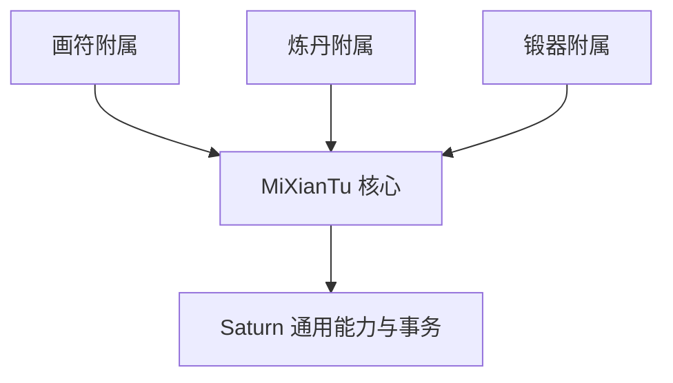

# 三个工作站独立附属拆分评估

状态：三个独立附属已落地，四工程编译与打包通过；本轮 90 组 GameTest 在五种安装组合中通过，客户端尚未实跑。下文保留拆分前调查，最终实施边界与验证状态见 §11。边界已按用户要求明确：本体统一提供工具、材料、载体与产物；附属提供生产工作流程和各自的工作站方块。本文不把符箓、丹药、灵植、法器和品质系统整体拆走。

## 1. 结论

**三个工作站可以分别拆成独立附属，且不需要重写核心玩法管线。** 推荐三个附属分别依赖 MiXianTu，彼此没有强制依赖；MiXianTu 可以在三个附属均未安装时独立运行。

工作站附属应包含完整的生产方式：工作站方块及其 BlockItem、容器、会话、生产结算、配方或蓝图、工作站专用数据定义、界面、网络、事件和联动。本体保留共用工具、材料、载体和产物的物品注册、外观与独立使用规则；多个附属直接使用同一批本体物品，避免各自注册一套相同物品。

工作站方块及其 BlockItem 由对应附属注册，因为它们承载各自特定的容器与交互。炉型、炉壁、锻造蓝图等工艺数据也随对应流程迁出。物品共享与工艺数据归属分开判断，不因某个工艺使用朱砂或残渣，就把这些普通物品一并迁走。

这里的箭头表示依赖方向。附属直接使用 Saturn、AUI 等类型时，其工程也应明确声明所需依赖；图中省略这些横向依赖。

| 附属 | 可行性 | 主要工作 | 相对复杂度 |
| --- | --- | --- | --- |
| 锻器 | 高 | 锻造数据和会话已有集中边界，清理注册入口、品质倍率、脚本与测试依赖 | 中 |
| 画符 | 高 | 保留本体符笔与颜料存量，迁移画符桌、笔画计费、判分与会话协议 | 中 |
| 炼丹 | 高 | 分离丹炉与灵植/丹药，断开药性读取、校验、品质载体和联动中的依赖 | 较高 |

拆分的主要成本在所有权和装配入口，计算规则本身大多可以原样迁移。拆分不会天然降低已安装工作站的运行开销；收益是核心不再装载这些生产方式，附属可以单独开发、替换和发布。

## 2. 调查口径与规模

检查对象包括主代码中的定义、运行服务、注册、网络、配置、界面、事件、JEI/Jade/KubeJS 联动，以及主资源和测试包。历史设计参考 `066_画符工作站设计.md`、`057_炼丹丹药与灵植闭环设计.md`、`016_锻造台UI与数据模型修订.md`，归属判断以当前代码为准。

以下只统计可以整体迁出的现有 Java 文件，按 §10 清单计算；行数包括空行与注释。公共注册类、需要拆开的混合类、资源、探针和新增附属入口均未计入，因此不是迁移后的总改动量。

| 范围 | 可整体迁出的 Java 文件 | 当前物理行数 | 其他主要登记项 |
| --- | ---: | ---: | --- |
| 画符 | 15 | 3,044 | 1 方块及其 BlockItem、1 菜单、1 配方类型、8 个 payload；符笔与颜料存量组件留核心 |
| 炼丹 | 41 | 4,758 | 5 方块、3 个 BE type、1 菜单、1 配方类型、3 张数据表、2 组件、2 个 payload |
| 锻器 | 24 | 3,450 | 1 方块、1 个 BE type、1 菜单、4 张数据表、3 组件、1 个 payload |
| 合计 | **80** | **11,252** | **7 方块及其 BlockItem、4 个 BE type、3 菜单、2 配方类型、7 张数据表、5 个流程专用组件、11 个 payload** |

`BrushPigmentService` 不再属于整体迁移文件：工具存量部分留本体，笔画计费部分迁附属，详见 §4.4。上表未计入这项按方法拆分的工作。

有两个容易误判的事实：画符工作站没有 BlockEntity，库存与会话归菜单；锻造没有独立的原版 RecipeType，而是走蓝图与锻打方式注册表。拆分应保留这两种实际形状。

## 3. 核心与附属的边界

### 3.1 核心继续提供什么

| 能力 | 保留范围 | 原因 |
| --- | --- | --- |
| 共用物品 | 符笔、朱砂、空白符纸、炼丹残渣及其他工具、材料、载体、产物的注册、模型、纹理、基础配方和通用标签 | 附属共用同一批物品，不因增加或更换生产流程而增加重复物品 |
| 工具自身状态 | 符笔颜料存量组件、容量、补充颜料、存量读写、物品条与 Tooltip | 这些行为属于工具自身，可被不同工作流程复用；笔画如何计费由画符附属决定 |
| 符箓 | `Talisman`、使用类型、组件、铭刻数据、灵气充能、使用/投掷、成品物品、命令与渲染 | 其他生产方式也可以产出符箓，不应必须安装画符桌才能使用 |
| 丹药 | `Pill`、`PillBinding`、丹药组件、服用次数、冷却、丹毒及其衰减 | 服药是产物使用行为，与是否用丹炉生产无关 |
| 灵植与药材信息 | `SpiritHerb`、`MedicinalProperty`、药龄、药性声明、成长与收获、区块附件、通用 Tooltip/Jade 信息 | 灵植自身有完整的世界行为，不只是丹炉输入 |
| 法器及普通物品 | 定义、物品绑定、灵力存储、能力、飞行、通用产出组件 | 锻造只是产出方式之一，也可以锻造普通物品 |
| 品质 | `ItemQuality`、品质组件、阶梯、需求判定、默认品质、`QualityProvider`、统一读取与写入 | 三个附属共同消费同一套品质，不各造一份 |
| 费用和公式 | Saturn 的 Cost/付款事务、Result/Failure、条件、行为、数值公式；MXT 的灵气来源接入 | 工作站迁移不改变统一结算规则 |
| 界面基础 | `AuiContainerScreen`、通用元素/样式辅助、公共主题与生命周期处理 | 核心的其他页面仍然在使用 |
| 其他生产设施 | 灵气工作台、其配方/菜单/JEI 联动 | 不属于本次三个工作站 |

Ponder 当前服务于阵法预览，也留在核心。不能因为丹炉同样是多方块，就把阵法预览或整个多方块相关工具一并迁走。

### 3.2 画符附属

迁出画符工作站方块及其 BlockItem、符方配方、笔画计费与判分、画符会话和全部画符网络/UI。符笔物品、颜料存量组件及补充颜料等工具自身逻辑保留本体。

`TalismanDrawingRecipe` 中的纸张需求、符形、引导方式、评分权重、档位、成功/失败产出和成本，都是生产工艺数据，随附属迁出；其中引用的 `Holder<Talisman>`、`Holder<ItemQuality>` 和 Cost 则继续指向核心/前置定义。

工具和耗材归属为：

- 符笔、朱砂、空白符纸以及朱砂基础合成配方保留本体，即使目前主要由画符流程使用，也不在附属中重复注册。
- `brush_pigment`、`talisman_paper` 作为共享物品分类标签保留本体；画符附属消费这些标签，内容包可以继续扩展它们。
- `BRUSH_PIGMENT`、符笔充填、存量条和 Tooltip 保留本体；按笔画长度计算扣量、笔画次数与点数限制归画符附属。
- 成品符箓、已有的符箓使用组件和使用命令保留。移除画符附属后，内容包仍可通过其他配方、战利品或命令生成能正常使用的符箓。

判分算法虽然是纯计算，仍然属于画符玩法。无需为了拆分把它提升成核心的通用图形服务。

### 3.3 炼丹附属

迁出丹炉的五种方块、三种 BE type、结构识别、部件槽位、热源读取、温度与批次状态、配方匹配和开炉结算，以及全部丹炉界面、网络和联动。

**炉子材料相关的数据驱动部分要整套迁出：**

| 当前数据表 | 定义内容 | 同步迁出的部分 |
| --- | --- | --- |
| `mxt:alchemy_furnace` | 主/辅槽位、炉型品质、容量、冷却速度、自身温度上限 | 定义与 Codec、Holder 引用、组件、Picker、Tooltip、加载和同步登记 |
| `mxt:alchemy_wall_material` | 炉壁品质、耐温上限 | 同上，加结构检查中的材质/耐温规则 |
| `mxt:heat_source` | 方块/标签、最高温度、每 tick 加热量、优先级 | 定义与 Codec、缓存、接口优先于数据表的规则、Picker、Tooltip、Jade 两端 |

目前炉壁定义实际带 `quality`，不能沿用旧稿中“不带品质”的边界。两种品质载体继续使用核心 `QualityProvider` 和品质阶梯，只是载体组件与注册动作由炼丹附属持有。

`AlchemyWorkstation`、`AlchemyHeatSource` 虽然位于 `api/`，也应迁走：前者暴露炉型、丹炉结构和批次状态，后者专门定义丹炉供热。公开 API 不代表必须由核心拥有。

`ALCHEMY_DREGS` 等普通残渣/材料物品保留本体，炼丹附属通过输出配置引用它们。即使物品当前没有其他流程消费，也不改变统一由本体提供物品的边界。丹炉五种方块对应的 BlockItem 是工作站组成部分，随方块迁到附属。

药性表、灵植、药龄和丹药定义保留。炼丹附属消费这些定义，不复制一套“附属灵植”或“附属丹药”。

### 3.4 锻器附属

迁出 `data/forging/`、`runtime/forging/` 的现有生产逻辑，以及锻造台方块/BE、菜单、界面、动作包、事件和失败类型。

| 当前数据表 | 用途 | 归属 |
| --- | --- | --- |
| `mxt:forging_blueprint` | 材料需求、允许方式、数值条、末尾序列、步数、品质结算和产物 | 锻器附属 |
| `mxt:forging_method` | 单次锻打的数值变化与费用 | 锻器附属 |
| `mxt:tool_binding` | 物品解锁哪些锻打方式 | 锻器附属 |
| `mxt:blueprint_binding` | 物品解锁哪些蓝图 | 锻器附属 |

`ForgingResultComponent` 虽然位于 `data/artifact/`，仍应迁出：它记录蓝图 Holder、最终数值和步数，是锻造过程信息。产物的通用品质写入核心 `mxt:quality`；法器本身的使用不依赖这份锻造记录。

`FORGING_METHODS`、`FORGING_BLUEPRINTS` 和 `FORGING_RESULT` 三个组件归附属。最优步数、数值条和失败退料等规则也归附属，不把它们拆成核心第二套生产管线。

这些组件可以附加到本体或其他模组已有物品上，无需为一种锻打方式、蓝图或锻造产物再注册同类物品。组件引用工艺数据，不等于物品注册也归附属。

## 4. 不能直接整包搬走的连接

### 4.1 灵植服务和 Tooltip 引用了丹炉角色

当前 [SpiritHerbService](../src/main/java/com/iafenvoy/mxt/runtime/alchemy/SpiritHerbService.java) 的 `potency` 接受 `recipe.AlchemyRole`，嵌套的 `HerbPotency` 还包含角色是否可入炉的判断；[SpiritHerbTooltipAppender](../src/main/java/com/iafenvoy/mxt/data/alchemy/SpiritHerbTooltipAppender.java) 同样调用这一条路径。

建议边界：

- 核心负责灵植归属、药龄、药性定义和不依赖工作站角色的数值求值。Tooltip 继续展示这份药材信息。
- 炼丹附属负责把主药/辅药/药引槽位映射到对应药性通道，构造炉内混合物，并判断能否放入该槽位。
- `AlchemyRole` 及炉内适用性留在附属；核心使用药性访问器或纯求值方法，不再引用附属枚举。通用数值求值只有一个出口，避免 Tooltip 与丹炉各复制一套公式求值规则。

这属于断开依赖，不要求同时改动整份 `SpiritHerb` 数据格式。其现有药性、药引强度与寒热等字段可继续作为药材元数据保留。

### 4.2 品质定义里含有两个工艺专属字段

[ItemQuality](../src/main/java/com/iafenvoy/mxt/data/quality/ItemQuality.java) 当前直接定义 `forging_modifier` 和 `alchemy_modifier`，[ItemQualityTooltipAppender](../src/main/java/com/iafenvoy/mxt/data/quality/ItemQualityTooltipAppender.java) 也直接展示它们。前者影响锻造额外步数折算，后者影响丹炉材料/炉型对批次时长的修正。

仅为独立加载，这两个可选字段可以暂留：它们不包含工作站类引用。但这样只能叫“工作站实现拆出”，核心定义仍然有工艺语义。

**推荐完整拆分时，将两个固定字段收为核心的通用修正映射。** 核心保留“按标识取一个带描述的公式修正值”的容器、Tooltip 和求值；锻器与炼丹附属各自声明键，以及该值究竟怎样影响步数/时长。经济价值修正等其他核心行为照常保留，不借此重写品质阶梯。

建议沿用当前语义：缺失键默认 `1`，非有限或非正倍率回退 `1`；最低材料倍率的选取、批次时长缩短、额外步数折算仍各归对应工艺。映射中的标识只是数据键，无需为此新增注册表或通用工作站框架。

这会涉及字段调整和品质 JSON 示例迁移，需要在实际实施前确定；不是本轮已经修改的内容。如果先做最小拆分，应明确登记这两个字段为尚未清理的边界。

### 4.3 品质载体注册应由炼丹附属执行

[QualityCarriers](../src/main/java/com/iafenvoy/mxt/runtime/item/QualityCarriers.java) 当前直接注册炉型与炉壁组件。核心移除这两条，炼丹附属在安全的初始化阶段调用现有公开 `QualityService.carry` 即可。

不需要为每个附属增加专用品质查询 API。需要保证只注册一次，并在物品品质开始查询前完成注册。

### 4.4 符笔自身存量与笔画计费需要拆开

[BrushPigmentService](../src/main/java/com/iafenvoy/mxt/runtime/talisman/BrushPigmentService.java) 同时提供颜料充填/存量操作和笔画扣量计算，且直接引用 `TalismanDrawingScorer.Point`。按修订后的边界，不能整类迁出，也不能原样留核心后继续引用附属的笔画类型。

本体保留颜料标签、容量、存量、充填、存量是否足够及可复用的扣除操作；附属负责 `chargeFor`、`chargeForStroke`、笔画路径长度，以及笔画与会话的校验。附属算好数量后调用本体工具存量接口扣除，不在各附属复制一套工具存量逻辑，也不改变颜料不走玩家 Cost 的现有语义。

`TalismanBrushItem` 的容器点击充填、物品条与反馈仍由本体提供。[TalismanTooltipAppender](../src/main/java/com/iafenvoy/mxt/runtime/talisman/TalismanTooltipAppender.java) 中的符笔存量显示也可继续保留，因为它只依赖本体物品与本体存量读取；画符结果或工艺说明才由附属显示。

### 4.5 数据校验混合了灵植与丹炉职责

拆分前 `AlchemyDataValidation` 在同一次回调里既校验灵植排他认领，又检查炼丹配方产物的组件感知堆叠上限。现在灵植部分由本体的 [HerbDataValidation](../src/main/java/com/iafenvoy/mxt/runtime/alchemy/HerbDataValidation.java) 保留，产物校验随炼丹流程迁出。

灵植校验留核心，炼丹配方产物校验随附属迁移。两边都要保留当前“组件默认值绑定完成后再校验”的加载时机，不能简单换成更早的标签事件，也不能搬走整类后漏掉核心校验。

### 4.6 配置按字段归属拆开

[MxtServerConfig](../src/main/java/com/iafenvoy/mxt/config/MxtServerConfig.java) 的 `Talisman` 类同时装有使用冷却、笔画限流/预算和颜料参数。核心保留符箓使用冷却、符笔 `brushCapacity` 和 `pigmentPerItem`；画符附属持有笔画限流/预算及 `pigmentRate`、`pigmentFloor`、`pigmentCap`，后者决定具体画符流程如何收费。

相反，目前 `Alchemy` 配置类只有 `herbCatchUpTicks` 和 `toxicityDecayPerSecond`，分别服务灵植补算和丹毒衰减，都应保留。不能因分类名叫 Alchemy 就整个搬走。

### 4.7 中央列表里的工作站来源也要迁走

`FailureSources` 中丹炉与锻造蓝图的来源、`CostSources` 中画符/锻造来源，以及 `MxtProfilerSources` 中纯工作站的统计项应由附属持有。通用 Failure/Cost/profiling 实现继续复用 Saturn。

当前符箓统计同时覆盖使用行为与画符流程；核心保留符箓使用统计，画符附属注册自己的统计项。不能把 `TALISMAN` 来源整体移除而影响使用端。

## 5. 注册、网络与第三方联动

这些文件都是共享装配点，按成员拆，不整体搬：

| 装配点 | 需要处理的内容 |
| --- | --- |
| `MxtResourceKeys`、`MxtDatapackRegistries` | 7 张工作站数据表迁至各附属的原版 datapack registry 登记，保留加载/客户端同步行为；核心不注册空壳表 |
| `MxtBlocks`、`MxtItems`、`MxtBlockEntities` | 7 方块、相应 BlockItem、4 个 BE type 由附属注册；符笔、朱砂、空白符纸、残渣等工具材料和产物继续由本体注册 |
| `MxtMenus`、`MxtRenderers` | 3 个菜单与各自 Screen 登记迁出；符箓投掷实体渲染仍留核心 |
| `MxtRecipeTypes`、`MxtRecipeSerializers` | 只迁炼丹与画符两组；灵气工作台配方保留 |
| `MxtDataComponents` | 炼丹 2、锻造 3 个流程专用组件迁出；符笔 `BRUSH_PIGMENT` 等共享工具自身状态保留本体 |
| `NetworkManager`、两端 Handler | 附属自行注册和处理 11 个 payload；核心不再用工作站菜单类型做分支 |
| `RegistryCaches` | 丹炉热源缓存的实例与初始化随附属迁移，否则核心可能查询已不存在的热源注册表 |
| `PickerCategories` | 炉型、炉壁、热源、锻打工具/蓝图绑定等分类由附属自行注册；通用 Picker 和灵植/符箓分类留核心 |
| `MxtCriteriaTriggers` | `ALCHEMY` 成功开炉触发器迁至炼丹附属，其他核心触发器不动 |
| `AuiPages` | 各工作站页面常量/选择逻辑归附属；通用页面预热、主题和工具可复用 |

`MxtDatapackRegistries.registries()` 还用于 `/mxt registries` 的本体列表。拆分后可以继续只列本体数据表，附属提供自己的诊断；若要统一显示所有模组数据表，应另用通用发现/登记方式，不能把附属常量重新写回本体列表。

第三方接入建议：

- **JEI**：`AlchemyCategory`、`AlchemyJeiText`、炼丹分类/配方/工作站登记归炼丹附属；`MxtJeiPlugin` 的灵气合成部分留核心。目前没有需要同步迁出的画符或锻造专用 JEI 分类，不凭空补功能。
- **Jade**：`HeatSourceDataProvider` 与 `HeatSourceComponentProvider` 及两端登记归炼丹附属；灵植、灵气工作台和展示架等 provider 留核心。
- **KubeJS**：`AlchemyCraftEvent`、`ForgingEvent` 和工作站生命周期转发归附属。目前 `MxtKubeJsEventDispatcher` 用固定 handler/switch 分派，附属不能仅发一个新的字符串就自动接通。建议附属拥有自己的插件与事件分组，保持原有取消语义；如果要求保留原 `MxtEvents` 调用形状，需要另行把事件登记扩展化。
- **创造栏**：本体继续展示共享工具、材料与产物；附属只为自己的工作站 BlockItem 登记展示入口，不复制本体物品。

三者继续复用现有 AUI。核心还有裂隙编辑器、信息面板等页面，因此本次拆分不构成移除核心 AUI 依赖的理由，也不构成移除 Ponder/Catnip 的理由。没有发现为拆分新增 MC Mixin 的必要。

## 6. 资源、数据包和探针范围

### 6.1 主资源

随附属迁移各工作站的 blockstate、BlockItem definition、模型与纹理、方块掉落、GUI 背景、流程专用语言键和配置文案。丹炉模型还有分部件模型目录，不能只搬顶层几个 JSON。符笔、朱砂、符纸、残渣及产物的 item definition、模型、纹理、基础配方和物品说明保留本体；混合 lang/config 文件按归属拆，不按名称前缀全搬。

AUI 页面范围为：

- `assets/apricityui/apricity/mxt/talisman/`：1 页 HTML + 1 份 CSS。
- `assets/apricityui/apricity/mxt/alchemy/`：4 页 HTML + 1 份 CSS。
- `assets/apricityui/apricity/mxt/forging/`：1 页 HTML + 1 份 CSS。

这些页面引用公共主题；迁移后要统一调整相对路径，或保留已验证的资源路径继续引用核心主题。AUI 页面由其自己的资源根解析，不可只根据附属 mod id 换目录而忽略加载规则。

`data/mxt/tags/{block,item}/workstations.json`、原版挖掘标签等混合文件只删除移出的工作站条目；附属用自己的资源文件追加到公共标签。核心资源不能硬引用未安装附属的方块/BlockItem。`brush_pigment` 和 `talisman_paper` 中的共享物品继续存在，标签保留本体。

主资源目前没有这 7 张专用注册表的默认条目，也没有炼丹/画符专用配方；具体例子集中在测试包。迁移数据驱动逻辑的重点是定义、Codec、注册与消费端，不能因为主资源没有 JSON 就认为没有这部分范围。

### 6.2 当前测试数据

按 JSON 所属目录和配方 `type` 统计：

| 测试数据 | 当前数量 | 建议归属 |
| --- | ---: | --- |
| 炉型 / 炉壁 / 热源定义 | 5 / 2 / 3 | 炼丹附属测试包 |
| 炼丹配方 | 22 | 炼丹附属测试包 |
| 锻造蓝图 / 方式 / 工具绑定 / 蓝图绑定 | 3 / 11 / 4 / 3 | 锻器附属测试包 |
| 画符配方 | 3 | 画符附属测试包 |

这只是直接专用数据，不含标签、品质、药材、符箓定义、模型与语言文件。`default_quality/alchemy_furnace.json` 这样的跨表数据也要迁到炼丹测试包；用于通用品质、灵植、丹药和符箓使用验证的基础定义则保留核心，或由附属测试包提供自身所需的最小独立夹具。

### 6.3 探针不能按文件夹全搬

- `AlchemyProbes`、`AlchemyGateProbes` 及 `AlchemyTestHeatBlocks` 归炼丹附属；`PillProbes`、灵植探针与 `HerbTestBlocks` 保留。
- `DrawingProbes` 的画符集成场景、`StationProbes`、`TalismanSessionVerifyProbes` 归画符附属；`TalismanProbes` 当前只有判分场景，也整体迁走。`DrawingProbes` 还通过工作站测试符笔充填，应把其中工具充填、容量、存量条等行为独立覆盖到核心，工作站槽位集成仍在附属验证。符箓使用侧的 `TalismanVerifyProbes` 保留核心。
- `QualityProbes` 混有通用品质、锻造输入、画符纸张与丹炉门槛场景，必须按场景分开。锻造相关现有探针也在这里，不能因为没有独立 ForgingProbes 文件就漏掉。
- `ProbeTests`、夹具和测试模组初始化应相应解耦。核心测试编译不能反向依赖三个附属；跨附属流程另作集成验证。

不建议为这次拆分顺手把整个测试框架再做成一份前置模组。先保证四个工程的测试都能独立编译和运行。

## 7. 存档与标识策略

共享工具、材料、载体与产物的物品标识始终由本体提供，不需要接管或重命名。附属只处理自己的工作站方块/BlockItem、BE、菜单、流程组件和工艺数据的标识。

拆分代码所有权与更换注册标识是两件事。对这些迁移条目，独立附属可以接管原有 `mxt:*` 标识，也可以使用新的附属命名空间；前者能减少数据改动，但需要确保核心与附属不会重复注册。

建议首轮保留迁出条目的现有静态注册和数据表标识，由附属接管，避免把拆分与全量重命名混在一起。附属工程、mod id 和 Java 包名仍然独立。若目标是立刻切换迁出条目的命名空间，应作为明确的不兼容变更，完整改写相关内容包和测试夹具，不承诺自动兼容。

需要单独验收的持久化边界：

| 对象 | 当前状态所有者 | 风险 |
| --- | --- | --- |
| 画符过程 | 菜单中的临时会话 | 关闭会话的取消/失败/退款和返还纸张语义需保持；没有可直接迁移的画符 BE 存档 |
| 丹炉 | 核心炉 BE 的批次/温度状态，部件 BE 的库存与材质等信息 | 方块/BE/组件/配方引用和进行中批次都需恢复，不能只验证空炉 |
| 锻造 | 锻造台 BE 的蓝图、冻结计划、会话、锁定材料与发起者 | 进行中会话、失效计划退料、剩余材料必须验证，不能重新计算并改变既有步数 |
| 已完成锻造产物 | `mxt:quality` 与锻造结果组件 | 核心品质继续可用；结果组件引用附属蓝图 Holder，附属缺失时不能承诺整份物品记录仍可无损读取 |
| 符笔、朱砂、符纸、残渣等共享物品 | 本体物品注册；符笔存量也归本体 | 普通物品及符笔存量不因移除画符流程失去注册，需验证核心独立读档 |
| 炉型/炉壁 BlockItem、带工艺数据的共享物品 | 方块物品/流程组件归附属，共享物品本身归本体 | 专用组件或 Holder 所属表缺失仍影响该附加记录的读取；共享物品注册保留不代表所有附加数据无损 |

**独立可选安装不等于可以随时无损卸载。** 无附属的新世界应正常工作，且仍有本体的共享物品。已有世界卸载拥有工作站方块/流程组件的附属，仍存在工作站、进行中批次和专用附加记录的读取边界；基础物品留本体能减少影响，但不构成这些记录的无损保证。缺失条目的实际处理取决于加载路径，必须用备份世界验证。

## 8. 推荐实施顺序与验收

1. 先确定三个附属的工程/mod id、原标识是否接管、是否保留旧存档，以及品质固定倍率字段的处理方式。这些选择会影响后续资源和夹具路径，实施时再确认。
2. 在核心准备有限的边界整理：灵植角色依赖、符笔存量与笔画计费分离、灵植校验保留、配置拆分；若采用完整方案，同步引入通用品质修正映射。每一步保持现有三个工作站仍可用。
3. 先迁锻器，验证附属注册、独立网络、脚本和品质接入路径；再迁画符；最后迁炼丹，处理药材、结构与批次恢复。
4. 每迁一站，同批迁出工作站注册、工艺数据、流程资源、事件、联动和探针，并删除核心对应流程引用；共享物品与工具基础行为保持由本体提供。
5. 同步两份 README 模块表、双语工作站教程/JSON 文档、API 与 KubeJS 说明、测试示例、学习资料中的归属信息。核心文档保留通用产物使用入口，并链接对应附属的生产方式。

验证矩阵应至少覆盖：

| 组合/场景 | 验证目标 |
| --- | --- |
| 仅核心 | 编译、数据包加载、独立服务器启动；共享工具/材料/产物及符笔充填/存量正常；符箓使用、丹药、灵植、法器、品质、灵气工作台均不依赖附属 |
| 核心 + 任意一个附属 | 三种分别独立加载；自身方块、数据表、界面、网络和生产完整，其他两站不存在 |
| 核心 + 全部附属 | 工具、材料与产物共用同一批本体注册物品；无重复注册；数据表/组件同步正常；共用品质、Cost 和公共标签不相互覆盖 |
| 缺少可选联动 | 不因 JEI/Jade/KubeJS 缺失加载它们的类型，且普通生产仍正常 |
| 专用服务器 | 不加载客户端 Screen/AUI 客户端类 |
| 数据包重载与异常定义 | 引用失效、进行中批次、计划恢复、材料返还、校验时序与优先级不变 |
| 重进与存档 | 丹炉运行、锻造锁料、已产出物品、专用组件在退出/重开后保持一致 |
| 客户端实机 | 三个界面布局、槽位、并发操作、画符限流、JEI/Jade 实际显示与网络权限 |

编译和 GameTest 无法替代客户端画面、真正的进程重启与旧世界读取验证。实施时仍按仓库规则，在启动游戏验证前确认。

## 9. 范围建议与开放项

推荐把本次实施定义为：**本体统一提供共享物品，三个附属分别提供工作站方块和完整工作流程，核心做有限解耦**。

必做范围是 §2 的 80 个整体迁移文件、共享装配点中的相关成员、§4 的混合职责、工作站专用资源/数据/探针。符笔、朱砂、符纸、残渣和产物不迁出，也不在附属重注册。推荐同时完成品质修正字段泛化，避免核心继续添加具体工艺字段。

本次不需要：新的通用工作站管理器、第二套 Cost/品质/药材、全量核心包改名、迁移丹药/法器/符箓使用、把 AUI/Ponder 从核心删除、为拆分新增 Mixin。

尚需实施前确定的产品选择：

- 三个附属各自的名称、mod id，以及采用独立仓库还是一个多工程仓库发布三个 Jar。两种工程形式都支持上述依赖边界。
- 对工作站与流程条目保留现有标识接管注册，还是改为附属标识并明确不迁移；原世界的支持范围。共享物品留本体已确定。
- 品质两个固定工艺字段是首轮泛化，还是记录为下一阶段边界清理。
- KubeJS 是否需要保持原 `MxtEvents` 调用形状；不要求时，各附属自有事件组更直接。

## 10. 可整体迁移的主代码清单

本节路径均相对于 `src/main/java/com/iafenvoy/mxt/`；只列完整文件迁移候选，混合类及中央注册文件见 §4、§5。

### 10.1 画符：15 个文件

| 目录 | 文件 |
| --- | --- |
| `item/block/` | `TalismanWorkstationBlock` |
| `screen/menu/` | `TalismanWorkstationMenu` |
| `screen/gui/` | `TalismanWorkstationScreen` |
| `recipe/` | `TalismanDrawingRecipe` |
| `runtime/talisman/` | `TalismanWorkstationService`、`TalismanDrawingSession`、`TalismanDrawingScorer` |
| `network/payload/` | `TalismanSelectC2SPayload`、`TalismanStrokeC2SPayload`、`TalismanSubmitC2SPayload`、`TalismanCancelC2SPayload`、`TalismanDrawingListS2CPayload`、`TalismanDrawingStartS2CPayload`、`TalismanStrokeAckS2CPayload`、`TalismanResultS2CPayload` |

### 10.2 炼丹：41 个文件

| 目录 | 文件 |
| --- | --- |
| `api/` | `AlchemyWorkstation`、`AlchemyHeatSource` |
| `data/alchemy/` | `AlchemyFurnaceDefinition`、`AlchemyWallMaterial`、`HeatSource`、`AlchemyFurnaceTooltipAppender`、`AlchemyHeatSourceTooltipAppender` |
| `runtime/alchemy/` | `AlchemyAggregateContainer`、`AlchemyFurnaceShapes`、`AlchemyFurnaceStructure`、`AlchemyHeatService`、`AlchemyInventoryKind`、`AlchemyMixture`、`AlchemyPhase`、`AlchemyResolver`、`AlchemySession`、`AlchemySlots`、`AlchemyWorkstationService`、`AlchemyWorkstationState` |
| `recipe/` | `AlchemyRecipe`、`AlchemyRecipeInput`、`AlchemyRole` |
| `item/block/` | `AlchemyFurnaceBlock`、`AlchemyFurnaceCasingBlock`、`AlchemyFurnaceInventoryBlock` |
| `item/block/entity/` | `AlchemyFurnaceBlockEntity`、`AlchemyFurnaceCasingBlockEntity`、`AlchemyFurnaceInventoryBlockEntity` |
| `screen/menu/` | `AlchemyFurnaceMenu`、`AlchemyFurnaceMenus`、`AlchemyFurnaceView` |
| `screen/gui/` | `AlchemyFurnaceScreen` |
| `network/payload/` | `AlchemyActionC2SPayload`、`AlchemyStateS2CPayload` |
| `event/` | `AlchemyCraftEvent` |
| `runtime/resulting/failures/` | `AlchemyFailure` |
| `registry/cache/` | `HeatSourceCache` |
| `compat/jei/` | `AlchemyCategory`、`AlchemyJeiText` |
| `compat/jade/` | `HeatSourceDataProvider`、`HeatSourceComponentProvider` |

### 10.3 锻器：24 个文件

| 目录 | 文件 |
| --- | --- |
| `data/forging/` | `ForgingBlueprint`、`ForgingMethod`、`ToolBinding`、`BlueprintBinding`、`ForgingBindingTooltipAppender` |
| `runtime/forging/` | `ForgingBindingService`、`ForgingCancellation`、`ForgingEventBridge`、`ForgingPlan`、`ForgingRateLimiter`、`ForgingService`、`ForgingSession`、`ForgingSessionView`、`ForgingSurface`、`ForgingTableState`、`ForgingWorkstationService` |
| `item/block/` | `ForgingTableBlock` |
| `item/block/entity/` | `ForgingTableBlockEntity` |
| `screen/menu/` | `ForgingMenu` |
| `screen/gui/` | `ForgingScreen` |
| `network/payload/` | `ForgingActionC2SPayload` |
| `event/` | `ForgingEvent` |
| `runtime/resulting/failures/` | `ForgingFailure` |
| `data/artifact/` | `ForgingResultComponent` |

## 11. 实施结果与验证状态

### 11.1 已实施边界

| 工程 | mod id | 内容 |
| --- | --- | --- |
| `E:/Java/AlchemyWorkstations` | `mxt_alchemy` | 丹炉核心、炉壁、进出料部件、炉型/炉壁数据、炼丹配方、会话、网络、JEI 与独立 KubeJS 事件组 |
| `E:/Java/ForgingWorkstations` | `mxt_forging` | 锻造台、蓝图/方式/绑定表、工艺组件、会话、网络与独立 KubeJS 事件组 |
| `E:/Java/TalismanWorkstation` | `mxt_talisman` | 画符台、画符配方、笔迹判分、会话、笔画配置、计费与网络 |

§10 的 80 个主文件最初整体迁出，其中 7 个通用热源文件随后迁回本体（见 §11.4），最终整体迁出 73 个原主文件，中央装配中的相应注册和处理分支也已移除。三个附属接管原有 `mxt:*` 注册标识，Java 包和 mod id 独立；本体没有反向依赖。每个工程包含独立 `test-mod`、中英 README 和 ARR 许可，发布 Jar 不包含测试包或本体代码。

本体继续提供符笔、朱砂、符纸、残渣、丹药、符箓等共享物品。符笔充填、容量与存量保留本体；笔迹长度和计费归画符流程。药材与药性保留本体，药材效果改用通用 EffectChannel，炉内角色由炼丹附属转换。灵植独占校验也仍在本体。

本轮保留 `quality` 定义中的 `forging_modifier` 与 `alchemy_modifier`，未实施 §4 提议的通用修正映射，避免把品质字段改版混入工作站拆分。KubeJS 不保留旧工作站事件入口，分别使用 `AlchemyWorkstationsEvents.process` 与 `ForgingWorkstationsEvents.process`。相关双语文档已同步。

工作站 BlockItem 与测试包辅助物品通过 `BuildCreativeModeTabContentsEvent` 加入本体的 MiXianTu 栏，不注册新创造栏。附属数据表复用本体登记入口，`/mxt registries` 包含当前已安装附属的表。

### 11.2 测试迁移与新增

| 所属 | 已迁移 | 新增 | 合计 |
| --- | ---: | ---: | ---: |
| 炼丹附属 | 28 | 1 组注册/创造栏 | 29 |
| 锻器附属 | 1 | 1 组注册/创造栏、2 组会话与材料边界 | 4 |
| 画符附属 | 16 | 1 组注册/创造栏 | 17 |
| 本体 | 原有通用探针保留 | 2 组工作站归属与符笔边界 | 2 组新增 |

附属共 50 组探针，本体新增 2 组。锻造新增场景验证真实方块实体的锁料、扣款锻打、会话 Codec 往返、取消后的精确退料，以及不足时不改库存。工作站专用配方、定义、测试方块/工具与资源已随探针迁移；公共品质、药材与产物使用夹具保留本体。

四工程的 `compileJava compileTestModJava processTestModResources build` 已通过；拆分阶段曾提供从相邻目录加载三个附属及其 test-mod 的联合验证入口，该入口现已移除，当前各附属均独立构建与运行。独立与共同安装的历史 GameTest 结果见 §11.3。中英语言键、JSON、80 文件迁移归属和 Jar 隔离检查通过。

### 11.3 游戏测试结果

用户已授权本轮全部验证组合。按限定选择器执行的 90 组不同探针通过，共计 192 次执行（跨组合重复验证）。全部定向批次均输出 `All N required tests passed`：

| 安装组合 | 工作站/边界检查 | 通用回归 | 总执行数 |
| --- | ---: | ---: | ---: |
| 仅本体 | 2 | 38 | 40 |
| 本体 + 炼丹 | 29 组完整流程 + 3 组归属 | — | 32 |
| 本体 + 锻器 | 4 组完整流程 + 3 组归属 | — | 7 |
| 本体 + 画符 | 17 组完整流程 + 3 组归属 | — | 20 |
| 本体 + 三个附属 | 50 组完整流程 + 5 组归属 | 38 | 93 |

通用回归包含丹药 11 组、灵植 8 组、品质 14 组、符箓使用 5 组，分别在仅本体与共同安装时实跑。三组独立安装都验证其他两个附属的工作站与数据表不存在；共同安装验证没有重复注册，全部工作站物品能在本体创造栏中找到。

日志在本体 `build/workstation-tests/`，以及三个附属各自 `build/workstation-tests-*.log`。多工程启动必须使用 `:runGameTestServer` 限定根任务；无冒号的同名任务选择器还会执行本体子工程的游戏测试。

另一次未限定路径的任务额外触发了本体全量 373 组测试，8 组失败，不能视为全量验收通过。失败集中在 profiler 与前置模组自带测试，未在本轮扩展修复根因；保留为后续独立排查项：

- 本体 `verify/profiling/gui_redraw`、`verify/profiling/server_status`：`Source is not part of this snapshot`，两份探针与拆分开始前一致。
- Saturn `information/builtins`、`information/group_selections`、`information/contexts`、`information/expressions`：信息行数量或表达式拒绝断言不符。
- Reincarnation `gametest/index_codec`、`gametest/codec_composition`：索引读取与 Codec 组合失败。

完整额外批次日志保留在 `build/workstation-tests/accidental-full-core.log`。这些项目的根因未在本轮确认，不将它们标记为已修复；拆分相关 90 组定向回归均已单独重跑通过。

客户端画面、可选联动在真实客户端的显示、真实进程重启恢复以及旧存档读取尚未实机验证；没有为本轮新增 Mixin。保留注册 ID 不等于已完成旧世界无损迁移验收，卸载附属也不保证专用工艺记录无损保留。

### 11.4 通用热源归属修订

按用户要求，`mxt:heat_source` 统一回归本体。定义、动态方块接口 `api/AlchemyHeatSource`、统一读取服务 `runtime/alchemy/AlchemyHeatService`、缓存、Picker、Tooltip 与 Jade 的两半显示均由本体提供；炼丹附属不再声明这张表、不再创建缓存和注册显示，只通过本体入口读取温度与升温速度。

本体现在提供 34 张数据包注册表，炼丹附属 2 张，锻器附属 4 张，画符附属没有独立数据包注册表。`mxt:heat_source` 的 ID、文件位置、字段、priority 规则和动态接口优先规则不变。炉型、炉壁、炉温推进及炼丹配方仍归炼丹附属。

炼丹专用供热方块与夹具继续放在附属测试包。本体补充只引用原版方块的独立夹具与 `verify/workstations/heat_sources` 探针，验证标签匹配、priority、统一读取、缺失热源、未加载区块与 Codec 校验；归属探针同时断言供热注册表始终存在且只登记一次。

本轮四工程 `compileJava compileTestModJava processTestModResources build`、资源 JSON、中英语言键、Jar 所有权与本体无反向依赖检查全部通过；双语文档构建通过。Jar 中的 7 个通用热源类只存在于本体，附属不再打包副本。

用户授权后，以下 4 批次全部通过，共 53 组不同 GameTest、85 次执行；§11.3 保留的是边界修订前的验证结果。

| 安装组合与范围 | 通过数 |
| --- | ---: |
| 仅本体：归属、符笔、通用供热 | 3 |
| 本体 + 炼丹：炼丹附属全部测试 | 29 |
| 本体 + 三附属：全部附属测试 | 50 |
| 本体 + 三附属：归属、符笔、通用供热 | 3 |

新增供热探针在仅本体和共同安装下均实跑通过；炼丹旧探针同时验证动态接口覆盖表值、熄灭状态与真实丹炉升温流程。各批次均输出 `All N required tests passed`，日志分别是本体 `build/heat-source-tests-core.log` 与炼丹工程 `build/heat-source-tests-alchemy.log`、`build/heat-source-tests-integration.log`、`build/heat-source-tests-joint-core.log`，汇总在本体 `build/heat-source-tests-summary.json`。

客户端 Tooltip、Jade 的实际画面未实跑；本轮没有新增依赖、Mixin 或协议字段。§11.3 记录的既存全量失败不在本轮范围，也没有被标记为已修复。

### 11.5 命名空间与文档目录后续修订

110 号稿将附属自有注册项切换到各自 mod ID，不再保留本稿拆分阶段使用的 `mxt:*` ID，也不提供别名或存档迁移。通用热源与共享物品继续归本体。当前 ID、独立文档目录和验证结果以 110 号稿为准；上文记录保留为拆分阶段的历史结果。

### 11.6 独立开发工程修订

三个附属不再通过 `include(":mxt")` 引入本体源码工程，正式依赖由各自 `build.gradle` 的 Curse Maven 坐标选择发行包。Jupiter、Saturn 与 ApricityUI 显式声明为运行依赖，不依赖 Curse Maven 提供本体的传递依赖。共享 `test-mod` 放在三个附属各自的 `libs/mxt-test-mod.jar`，供附属复用 Probe 框架与公共夹具；不再配置 `mavenLocal`、`mxt_version` 或独立测试包解析配置。测试包仅通过 `testModImplementation` 文件依赖加入测试源码集，不参与 Maven 版本仲裁，避免同名模块的测试包替换远程本体。测试包不作为附属发布依赖，也不进入主代码编译与普通运行路径。`dependencies` 按依赖、本体、兼容、测试四组排列。

导入任一附属时，Gradle 模型仅包含该工程，不要求本体或其他附属的检出目录相邻，也不会生成其他工程的 IDEA 模块或运行配置。三个附属之间的子工程引用、运行时项目依赖、跨工程模组注册与预编译任务均已移除，不再提供联调开关。开发步骤记录在各附属的 `DEVELOPMENT.md`。

三个附属均提供 `Test Client` 运行配置，使用 `testMod` 源码集与独立的 `run-test-client/` 游戏目录；支持通过 `mxtTestClientGameDirectory` 和 `mxtTestClientUsername` 覆盖目录与玩家名。普通 Client、Server、Data 使用 `main` 源码集，只加载正式模组，不编译或复制测试资源。Test Client 与专用 GameTest Server 加载共享测试 Jar 和当前附属的测试模组，后者独立使用 `run-game-test-server/`。

本体与测试包的本地发布、三个附属的主代码和测试代码编译、打包、启动配置生成及独立工程模型检查通过；三附属联合模式的编译与工程模型检查也通过。清理炼丹工作区缓存的本体模块链接及旧生成运行配置。此次为工程配置修订，未启动客户端、服务端或 GameTest，之前的游戏测试结果不作为本轮实跑结果。

本体远程依赖与本地测试 Jar 组合已通过三个工程的主代码、测试代码编译及打包。依赖检查确认两份 Jar 同时存在，测试包不进入主代码编译路径、发布 POM 或附属 Jar；三份本地测试包与下载原件的 SHA-256 一致。`curse.maven` 组限定从 Curse Maven 解析，避免访问无关仓库。本次未启动游戏或 GameTest。

Test Client 配置修订后，三个附属的主代码、测试代码编译、打包和启动脚本生成通过。三个独立工程与一次三附属联合模式的 20 组运行模型及对应启动脚本检查通过：普通入口排除共享测试 Jar 与测试模组，测试入口保留正式本体并加载测试内容；发布 Jar 不包含测试代码或夹具。联合检查后已恢复默认独立工程的启动脚本。本轮未启动客户端、服务端或 GameTest。

移除联调入口后，三个附属重新通过主代码、测试代码编译、打包与启动脚本生成。15 组运行模型及启动脚本检查确认：各工程只包含自身根项目，没有其他附属的项目依赖或工作区路径；普通入口与测试入口的隔离规则保持有效。开发说明同步移除了联调参数与相邻目录要求。本轮未启动客户端、服务端或 GameTest。
